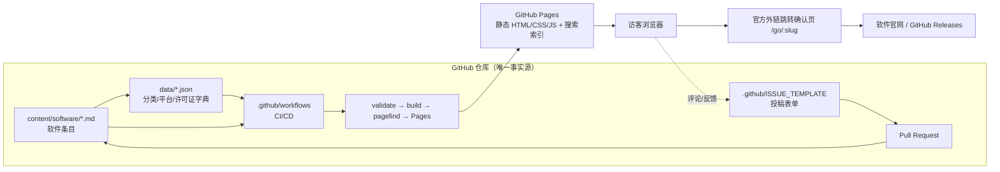
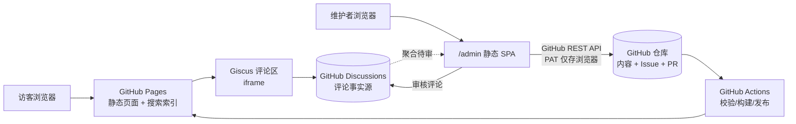
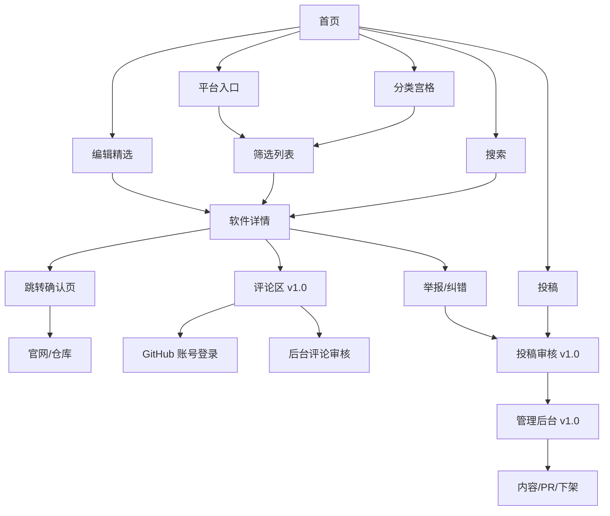
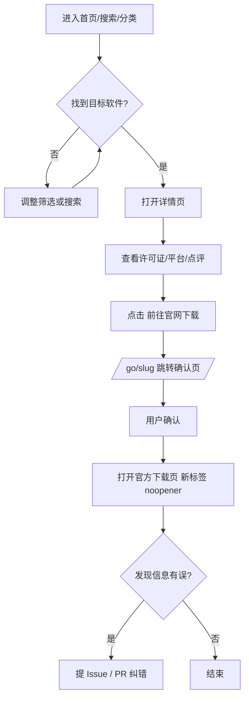
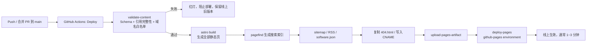
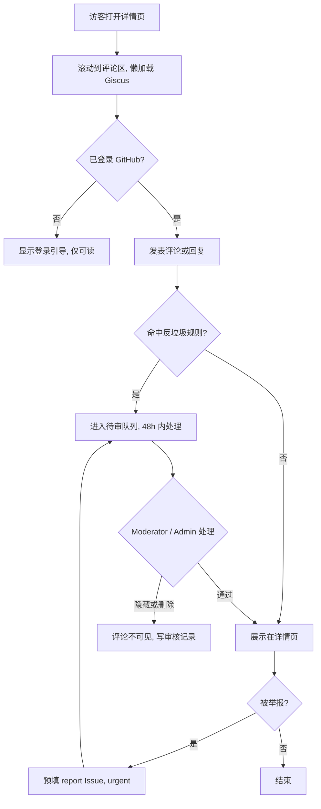
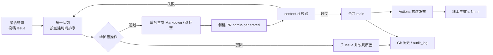
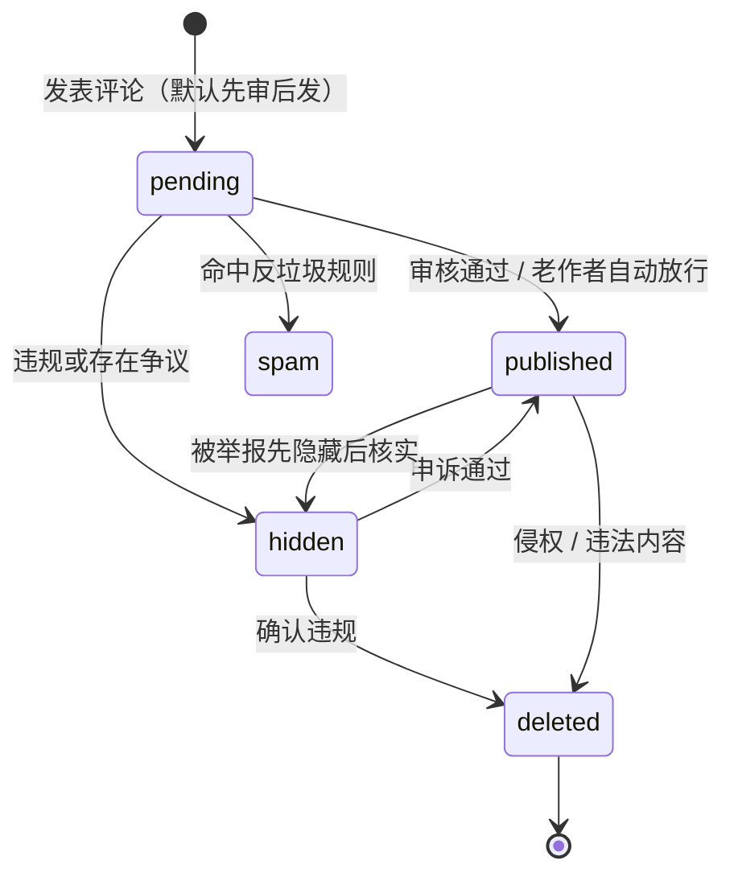

# 1024Soft
# A free, useful, open-source software website
# 1024Soft · 免费软件分享站 产品需求文档（PRD）

| 项目      | 内容                                                                                 |
| 产品名称    | 1024Soft                                                                           |
| 文档版本    | v1.1（产品 v1.0 范围调整）                                                                 |
| 编写日期    | 2026-11-04                                                                         |
| 文档状态    | 可直接进入开发 / v0.1 MVP 约 1~~2 周，\*\*v1.0 正式版约 4~~6 周\*\*                               |
| 目标读者    | 全栈开发、内容运营、开源协作者                                                                    |
| v1.0 范围 | **新增评论区 + 管理后台**（详见 F7 / F12 / F13），仍是零成本、可部署在 GitHub 的方案                          |
| 核心约束    | **零服务器成本、代码与内容全部托管在 GitHub、站点由 GitHub Pages + GitHub Actions 自动发布；架构必须可平滑扩展到动态后端** |
| 仓库示例    | `https://github.com/OWNER/REPO`，站点 `https://OWNER.github.io/REPO/`                 |

> **一句话结论**：全站以「**Git 即数据库 + 静态站点生成（SSG）+ GitHub Pages 托管**」为底座；软件条目是仓库里的 Markdown/JSON，GitHub Actions 负责校验、构建、索引与发布。v0.1 只做发现与投稿，**v1.0 补齐评论区与管理后台**，且优先用 GitHub 原生能力（Discussions/Giscus + 浏览器直连 GitHub REST API）实现，继续零服务器成本、继续部署在 GitHub Pages；团队规模化时再通过 `SoftwareRepository` 抽象把数据源切到 Supabase/Neon/D1 + Edge API，**页面组件与 URL 结构不变**。

**本次修订说明（文档 v1.1 / 产品 v1.0）**

| 变更项   | 内容                                                                                             |
| ----- | ---------------------------------------------------------------------------------------------- |
| 版本定义  | v1.0 从「远期平台化」改为「**带评论区 + 管理后台的正式可用版**」；原平台化内容顺延为 v1.1                                          |
| 新增模块  | F7 管理后台（重写）、F12 评论区、F13 统一审核工作台与权限模型                                                           |
| 架构    | 3.1 / 3.3 明确 v1.0 的**方案 A 零后端（主选）**&#x4E0E;**方案 B 全栈（可选）**&#x53CC;轨；P1 不再是「远期预留」，而是 v1.0 的交付范围 |
| 数据    | 4.5 评论数据模型、4.6 后台与审核队列模型（表、字段、状态、RLS）；原 4.5 顺延为 4.7                                            |
| 流程与接口 | 新增 7.7 评论流程、7.8 后台审核流程、7.9 权限状态机；8.2 补评论/后台 API，新增 8.4 契约细节                                    |
| 部署    | 新增 10.9：Giscus 配置、Maintainer Console（静态 SPA + PAT）、Workers 全栈方案、CI 与目录树调整                      |
| 验收    | 新增 12.2 v1.0 检查清单、TC-11~TC-18；风险表补评论合规、PAT 泄露、API 限流                                           |

> 术语口径：下文 **P0 = v0.1 纯静态版**，**P1 = v1.0 正式版**（评论区 + 管理后台，主选零后端实现；4.4 的数据库 DDL 与 8.2 的 REST API 属于 P1 的**方案 B 可选实现**），**P2 = v1.1+ 平台化**。

---

## 目录

1. [产品背景、定位与目标](#1-产品背景定位与目标)
2. [竞品调研与取舍](#2-竞品调研与取舍)
3. [总体架构与技术栈](#3-总体架构与技术栈)
4. [数据模型与字段字典](#4-数据模型与字段字典)
5. [功能模块详述](#5-功能模块详述)
6. [页面结构与 URL 约定](#6-页面结构与-url-约定)
7. [业务流程与状态机](#7-业务流程与状态机)
8. [接口契约设计](#8-接口契约设计)
9. [非功能性需求](#9-非功能性需求)
10. [GitHub 部署方案（重点）](#10-github-部署方案重点)
11. [里程碑与版本规划](#11-里程碑与版本规划)
12. [验收标准与测试用例](#12-验收标准与测试用例)
13. [风险登记表](#13-风险登记表)
14. [附录](#14-附录)

---

## 1. 产品背景、定位与目标

### 1.1 要解决的问题

1. 免费开源软件散落在官网、GitHub、网盘、论坛、网文里，用户很难判断「是否真免费、是否停更、是否捆绑、支持哪些系统」。
2. 传统下载站（Softpedia、各类中文下载站）**托管安装包、广告密集、捆绑安装、镜像可信度不一**，安全与合规成本高。
3. 社区型站点（AlternativeTo、小众软件）内容质量高，但依赖账号体系与后台，个人开发者维护成本高。
4. 因此需要一个**只做「发现 + 结构化信息 + 官方链接跳转」**&#x7684;轻量站点：不托管任何安装包，不承担分发风险。

### 1.2 产品定位

> 一个由社区共同维护的、只收录**真正免费 / 开源 / 免费可用**软件的**结构化目录 + 发现站**。所有下载一律跳转软件官网或官方仓库，本站只提供信息、筛选、对比与可信标注。

**v0.1 的边界（这决定了起步架构能保持简单）：**

| 做（In Scope）                  | 不做（Out of Scope）           |
| ---------------------------- | -------------------------- |
| 软件条目、分类、平台、许可证、版本、更新日志摘要  | 托管/镜像任何安装包、 exe、dmg、apk 文件 |
| 搜索、多维筛选、榜单、相似软件推荐            | 账号注册体系（MVP）、私信、社交关系        |
| 社区投稿（Issue / PR）、编辑审核、下架、举报  | 在线安装器、自动升级、破解/激活码/序列号      |
| 官网/仓库外链跳转、链接健康检测             | 付费推广位、广告联盟（MVP）            |
| RSS、Sitemap、结构化数据、开放 JSON 数据 | 用户上传截图到本站（MVP 用外链或仓库内小图）   |

**v1.0 新增范围（本次修订）**

| 新增能力（In Scope）                        | 明确不做（Out of Scope）       |
| ------------------------------------- | ------------------------ |
| 详情页评论区：发表、回复、点赞、排序、举报                 | 不自建账号体系（统一用 GitHub 账号登录） |
| 评论审核、反垃圾、隐藏/删除、订阅通知                   | 不做评论私信、不公开用户邮箱、不做用户关注关系  |
| 管理后台：统一审核台、内容增删改查、评论管理、举报处理           | 不做通用 CMS、不做页面拖拽搭建        |
| 数据看板：收录量、待审量、失效链接、评论趋势                | 不做实时大屏、不做用户画像与广告投放       |
| 角色与权限：Admin / Moderator / Contributor | 不做付费权限、不做商业化计费           |
| 全量操作审计（Git 历史 + `audit_log`）          | 不收集 IP 明文、不做行为追踪         |

> v1.0 的「后台」不是新业务系统：它把原本手工做的 GitHub 操作（开 PR、改 Issue 标签、合并、下架、审评论）收拢到一个网页界面里，**内容的唯一事实源仍然是 Git 仓库**，因此不破坏可回滚、可审计、零成本三项约束。

### 1.3 用户与角色

| 角色                    | 典型诉求                | 主要动作                    |
| --------------------- | ------------------- | ----------------------- |
| 访客（Anonymous，占比 ~95%） | 快速找到「免费、可用、安全」的替代工具 | 搜索、筛选、看详情、点官方链接         |
| 投稿者（Contributor）      | 分享自己做的/喜欢的免费软件      | 提 Issue 或直接 Fork 提 PR   |
| 维护者（Maintainer）       | 保证信息准确、无恶意链接        | 审 PR、合并、下架、批量校对         |
| 评论者（Commenter，v1.0）   | 补充使用体验、纠错、提问        | GitHub 账号登录、发表/回复/点赞/举报 |
| 内容管理员（Admin，v1.0）     | 一个界面处理所有待办          | 后台审核投稿/评论/举报、改内容、看下板    |
| 协管（Moderator，v1.0 可选） | 分担评论与举报审核           | 仅能审评论/举报，不能改内容与权限       |
| 机器人（CI Bot）           | 保证数据格式与站点可用         | 校验 Schema、重建站点               |

### 1.4 成功指标（可量化，用于验收）

| 指标                         | v0.1 / v1.0 目标          | 测量方式                       |
| -------------------------- | ----------------------- | -------------------------- |
| 首屏 LCP（4G）                 | < 1.5 s                 | Lighthouse CI              |
| Lighthouse 性能 / 可访问性 / SEO | ≥ 95 / ≥ 95 / ≥ 100     | CI 中跑 lighthouse           |
| 构建产物体积                     | < 10 MB（200 条数据）        | `du -sh dist`              |
| 内容上线耗时                     | 合并 PR → 线上可见 ≤ 3 min    | Actions 运行记录               |
| 收录条目                       | 上线 30 条，3 个月 300 条      | `content/software/*.md` 计数 |
| 部署成本                       | 0 元/月（v0.1 与 v1.0 均须达成） | 账单核对                       |
| 评论区可用率（v1.0）               | ≥ 99%，首次加载 ≤ 2 s        | 手动抽样 + Lighthouse          |
| 评论审核时效（v1.0）               | 待审队列 ≤ 48 h 清零          | 后台看板 `moderation_queue` 统计 |
| 后台完成一次「投稿→上线」（v1.0）        | ≤ 5 分钟，无需打开 GitHub      | 端到端计时（TC-13）               |
| 越权操作拦截（v1.0）               | 100% 被拒                 | TC-16 权限用例                 |

### 1.5 设计原则

1. **Git as CMS**：内容是可 review、可回滚、可 blame 的纯文本，天然自带版本历史与协作审核。
2. **静态优先（SSG）**：所有内容页构建期预渲染成 HTML，无需运行时服务器，天然抗流量、抗攻击、SEO 友好。
3. **零密钥前端**：MVP 阶段浏览器不接触任何私密凭证；扩展阶段只用公开 anon key + 数据库 RLS。
4. **数据访问层与渲染层解耦**：页面只依赖 `SoftwareRepository` 接口，`GitRepository`（v0.1 / v1.0-A）与 `PostgresRepository`（方案 B）可替换；评论同理抽象 `CommentRepository` —— 这是「可扩展」的技术保证。
5. **不做分发**：所有下载外链统一经「跳转确认页」，标注来源与风险，降低法律与安全风险。
6. **GitHub 原生优先**：v1.0 的评论区用 GitHub Discussions（Giscus），管理后台用浏览器直连 GitHub REST API，**不为了让功能「看起来像后端」而引入服务器**；只有当维护者规模、审核量或匿名评论需求超过 GitHub 原生能力时，才启用方案 B。
7. **后台不另立数据源**：后台的所有写操作最终都变成一次 Git 提交 / PR / Issue 状态变更，Git 历史即审计日志，任何误操作可 `revert`。

---

## 2. 竞品调研与取舍

### 2.1 参考站点与可借鉴点

| 站点                                                                                                     | 形态           | 值得借鉴                                                       | 明确不借鉴                   |
| ------------------------------------------------------------------------------------------------------ | ------------ | ---------------------------------------------------------- | ----------------------- |
| [AlternativeTo](https://alternativeto.net/)                                                            | 众包「软件替代品」目录  | 以「替代关系」组织内容；平台 / 许可证 / 价格多维筛选；点赞 + 评论 + 审核后发布；新账号投稿有冷却期防垃圾 | 复杂账号体系、付费加急审核、广告驱动      |
| [Softpedia](https://www.softpedia.com/)                                                                | 编辑型下载百科      | 版本号、更新日志、截图、平台分区、「最新更新」流；条目信息结构非常完整                        | 托管安装包与镜像、广告密度、驱动/商业软件混杂 |
| [PortableApps](https://portableapps.com/) / [FossHub](https://www.fosshub.com/)                        | 免安装 / 开源软件分发 | 「便携版」「开源许可证」作为独立筛选维度                                       | 自建分发与文件校验链路             |
| [小众软件](https://www.appinn.com/) / 少数派                                                                  | 中文编辑推荐       | 一句话点评、场景化描述、中文语感                                           | 重内容运营、日更人力成本            |
| [Product Hunt](https://www.producthunt.com/)                                                           | 榜单型发现        | 每日榜单、热度排序、社区投票                                             | 登录墙、复杂互动                |
| GitHub `awesome-*` / [Flathub](https://flathub.org/) / [Chocolatey](https://community.chocolatey.org/) | 清单 / 包仓库     | Markdown 清单式维护、机器可读元数据、CI 校验                               | 包管理 CLI、安装流程            |

> 调研来源见[附录 14.3](#143-参考资料)；竞品功能与额度会随时间变化，本表取 2026-11 可观察到的公开形态。

### 2.2 竞品能力矩阵

| 能力         | AlternativeTo | Softpedia | 小众软件 | Awesome 列表 | **FreeSoftHub v0.1 / v1.0** |
| ---------- | ------------- | --------- | ---- | ---------- | --------------------------- |
| 分类           | ✅             | ✅         | ✅    | 目录即分类      | ✅                           |
| 平台筛选       | ✅             | ✅         | 部分   | ❌          | ✅                           |
| 许可证筛选      | ✅             | 部分        | ❌    | 部分         | ✅                           |
| 全文搜索       | ✅             | ✅         | 弱    | 浏览器 Ctrl+F | ✅（客户端索引）                    |
| 版本 / 更新记录  | 部分            | ✅         | ❌    | ❌          | ✅（结构化字段）                    |
| 用户投稿       | ✅ 需审核         | ✅         | ✅    | PR         | ✅ Issue/PR                  |
| 评论 / 点赞    | ✅             | 部分        | ✅    | ❌          | ✅ **v1.0**（Giscus 评论区）      |
| 托管安装包      | ❌             | ✅         | ❌    | ❌          | ❌ **刻意不做**                  |
| 维护成本       | 高             | 高         | 中    | 极低         | 极低                          |
| 可离线/可 Fork | ❌             | ❌         | ❌    | ✅          | ✅                           |

### 2.3 结论：MVP 的功能配方

- **取** Awesome 列表的「纯文本 + PR 协作」维护方式；
- **取** AlternativeTo 的「结构化筛选 + 许可证/平台维度」；
- **取** Softpedia 的「版本、更新时间、截图、外链集中展示」的详情信息密度；
- **取** 中文社区站的「一句话点评」语感；
- **补齐（v1.0）** 评论区与管理后台：借 AlternativeTo 的「评论先审后发、点赞排序」与主流 CMS 的「审核队列 + 角色权限」，但用 GitHub 生态（Discussions / Giscus / REST API）零成本实现，不引入自建服务端；
- **弃** 自建账号、文件托管、广告、通用 CMS —— 保持内容站简单可维护。

---

## 3. 总体架构与技术栈

### 3.1 三阶段演进（一套代码，逐层加能力）

| 阶段                  | 产品版本         | 架构                                                                         | 数据                                                                         | 部署                                                    | 触发条件                                   |
| ------------------- | ------------ | -------------------------------------------------------------------------- | -------------------------------------------------------------------------- | ----------------------------------------------------- | -------------------------------------- |
| **P0**              | v0.1 MVP     | 纯静态 SSG                                                                    | Git 内 Markdown + JSON                                                      | GitHub Pages（Actions 构建）                              | —                                      |
| **P1-A（v1.0 主选）**   | **v1.0 正式版** | SSG + **GitHub 原生交互层**：Giscus 评论区 + `/admin` 静态 SPA（浏览器直连 GitHub REST API） | 内容仍在 Git；评论在 GitHub Discussions；待审队列由 Issues / PR / Discussions 聚合         | **仍是 GitHub Pages**，零服务器、零密钥入库                        | 本次修订的目标版本                              |
| **P1-B（v1.0 可选实现）** | v1.0 的规模化路径  | 上面 + Cloudflare Workers / Supabase Edge Functions + Hono                   | Postgres（Supabase / Neon）或 D1，含 `comment`、`moderation_queue` 等表（见 4.4~4.6） | Pages 前端 + Workers/Supabase 免费层；**仓库与 CI 始终在 GitHub** | 需要匿名评论、多人在线协作、> 2000 条数据、评论量 > 500 条/月 |
| **P2**              | v1.1+ 平台化    | 前后端分离 + 完整权限体系                                                             | Postgres + 对象存储 + 搜索服务                                                     | 任意 Serverless / 容器                                    | 多语言、开放 API、商业化                         |


> 关键点 1：**P0 → P1-A 不引入服务器、不改页面组件与 URL**。评论区是第三方 iframe（Giscus），后台是一个静态 SPA，二者都由浏览器直接调用 GitHub 的公开 API，凭证只存在维护者本机浏览器里。
>
> 关键点 2：**P1-A → P1-B 不改页面组件与 URL**，只替换 `src/lib/repository/*` 与 `src/lib/moderation/*` 的实现，把数据源从 Git 文件 / Giscus 切到数据库 + 自建评论 API，并把构建改为「构建期读 API 生成静态快照 + 客户端增量请求」。
>
> 关键点 3：**v1.0 必须同时交付评论区和管理后台**，但两者相互独立：即使后台暂未接入自建 API（P1-A），评论区功能也必须完整可用；后台不可用时，所有操作仍可退回 GitHub 网页手工完成。


### 3.2 P0 架构图



### 3.3 v1.0 架构图（评论区 + 管理后台）

**方案 A（主选，零后端）**：



**方案 B（可选，自建 API）**：浏览器 → `/admin` → Cloudflare Workers（Hono + GitHub OAuth / 限流）→ D1/Postgres（`software` + `comment` + `moderation_queue`）；CI 每日把已发布内容导出为静态快照，数据库故障时前台与后台均回退到快照 + Git。

> 两张图的关键差异只在「写操作走 GitHub REST API 还是走自建 API」，**前台页面、字段、URL 完全一致**。v1.0 默认走方案 A，方案 B 是同一份 PRD 里预留的规模化分支。

### 3.4 技术栈清单（P0 主选 + 备选）

| 层              | 主选                                                                   | 版本基线    | 备选                                            | 选择理由                                                                                    |
| -------------- | -------------------------------------------------------------------- | ------- | --------------------------------------------- | --------------------------------------------------------------------------------------- |
| 语言             | TypeScript（strict）                                                   | TS 5.7+ | JavaScript                                    | 内容 schema 校验需要类型保障                                                                      |
| 前端框架           | **Astro 5（output: static）**                                          | 5.x     | Next.js static export / Vite + React / Hugo   | 内容站默认零 JS，按需岛屿（islands）才有交互；官方 GitHub Pages Action 支持最好；`content collections` 自带 schema |
| UI 样式          | Tailwind CSS 4 + 少量原生 CSS                                            | 4.x     | 原生 CSS / DaisyUI                              | 无运行时、构建期裁剪，体积可控                                                                         |
| 图标             | 内联 SVG / Lucide（按需打包）                                                | —       | 图标字体                                          | 避免额外请求                                                                                  |
| 内容             | Markdown + YAML frontmatter，`src/content.config.ts` 定义 Zod schema    | —       | JSON / MDX                                    | 人可读、PR diff 友好                                                                          |
| 搜索             | **Pagefind**（构建后生成分片索引，客户端按需加载）                                      | 1.x     | Fuse.js（< 300 条时更轻）/ MiniSearch               | 无需服务端、索引随内容增长自动分片、中文分词可用（需配置）                                                           |
| **评论区（v1.0）**  | **Giscus**（GitHub Discussions，iframe 嵌入详情页）                          | —       | 方案 B：`comment` 表 + 自建评论 API + Turnstile       | 零后端、GitHub 账号天然反垃圾、自带通知与反应                                                              |
| **评论审核（v1.0）** | GitHub Discussions 原生管理（隐藏/删除/锁定）+ 后台待审聚合视图                          | —       | 自建 `moderation_queue` + 关键词/频率规则              | 与 GitHub 权限一致，无需额外账号体系                                                                  |
| **管理后台（v1.0）** | `/admin` 静态 SPA（Preact + TypeScript + Tailwind，hash 路由）              | —       | Decap CMS（GitHub 后端）/ 方案 B 的独立后台              | 纯静态即可部署 Pages；只调用 GitHub 公开 API                                                         |
| **后台鉴权（v1.0）** | 维护者自持 fine-grained PAT，存浏览器 `sessionStorage`，不入库不上传                  | —       | GitHub OAuth App + Worker 代理 / Supabase Auth  | 仓库与 CI 中不存在任何密钥；PAT 权限收敛到单仓库                                                            |
| 后台数据访问         | `@octokit/rest`（浏览器端）→ Contents / Issues / Pulls / Discussions API   | 5.x     | 方案 B：`fetch('/api/v1/admin/*')`               | 每次写操作都落成 commit / Issue 事件，天然可审计                                                        |
| 数据校验           | Zod + 自定义 `scripts/validate-content.mjs`                             | 3.x     | Ajv + JSON Schema / Valibot                   | 与 TS 类型共用一套定义                                                                           |
| **后端（P0）**     | **无服务端**；GitHub Actions 承担「构建期后端」                                    | —       | —                                             | Pages 不支持运行时服务端代码是硬约束                                                                   |
| 后端（P1-A）       | **无自建服务端**；GitHub REST API 由浏览器直接调用                                  | —       | —                                             | v1.0 主选，成本 0、无运行时密钥                                                                     |
| 后端（P1-B 可选）    | Cloudflare Workers + Hono 或 Supabase Edge Functions                  | —       | Next.js Route Handlers / Vercel Functions     | 免费层 + TypeScript 同构；只在规模化时启用                                                            |
| **数据库（P0）**    | **Git 仓库即数据库**（文件系统 + JSON 索引）                                       | —       | —                                             | 免运维、免费用、天然审计与回滚                                                                         |
| 数据库（P1-B 可选）   | **Supabase Postgres**（Auth + Storage + RLS 一体）                       | PG 15+  | Neon Postgres / Cloudflare D1(SQLite) / Turso | 见 3.6 免费额度对比                                                                            |
| CI/CD          | GitHub Actions                                                       | —       | —                                             | 与 Pages 原生集成                                                                            |
| 托管             | GitHub Pages（Source = GitHub Actions）                                | —       | Cloudflare Pages / Netlify / Vercel（同样连同一仓库）  | 要求「部署在 GitHub 上」，Pages 是首选                                                              |
| 监控             | Actions 运行记录 + Lighthouse CI + 可选 Cloudflare Web Analytics（无 Cookie） | —       | Umami 自托管                                     | 不做侵入式追踪                                                                                 |
| 包管理            | pnpm 10（提交 lockfile）                                                 | —       | npm / bun                                     | Astro 官方 Action 依赖 lockfile 探测包管理器                                                      |

### 3.5 为什么不能用「动态站点」直接部署在 GitHub Pages

GitHub Pages **只提供静态文件托管**，不运行 Node/PHP/Python、不提供数据库、不接收 POST、不能持有运行时密钥。因此：

- 页面必须 SSG（构建期把数据烘焙成 HTML），Pages 上永远只有静态文件；
- 写操作不经过本站服务器，而是委托给**浏览器可直连的第三方可信 API**：v0.1 用 GitHub Issue / PR，v1.0 用 GitHub Discussions（评论）+ GitHub REST API（后台）。这些 API 由 GitHub 托管、由调用者自己的凭证授权，本站只是一层 UI；
- 因此 v1.0 的评论区与管理后台**仍然能部署在 GitHub Pages 上**：评论是 iframe，后台是静态 SPA，Actions 依旧只做构建发布；
- 只有确实需要匿名评论、服务端限流或跨站统一账号时，才引入 P1-B 的外部免费后端，但**代码仓库、CI、内容审核流仍在 GitHub**。

> 易错点：不要把「管理后台」理解成需要 Node 服务 + 数据库登录的后台。本 PRD 的 v1.0 后台是**纯客户端控制台**，它用维护者自己的 GitHub 凭证调用 `api.github.com`，服务端是 GitHub，不是本站。

### 3.6 免费额度与硬限制（2026-11 核对，实际以官方为准）

| 平台                 | 免费额度 / 限制                                                                         | 对本项目的含义                                       |
| ------------------ | --------------------------------------------------------------------------------- | --------------------------------------------- |
| GitHub Pages       | 公开仓库免费；站点产物建议 ≤ 1 GB；带宽软限约 100 GB/月；仓库建议 ≤ 1 GB；Actions 方式部署不受「每小时 10 次构建」的分支构建限制 | 300 条文本 + 少量图片远低于上限；**禁止把安装包放进仓库**            |
| GitHub Actions     | 公开仓库免费；私有仓库约 2000 分钟/月；单次部署 10 分钟超时；超过 60 天无提交的仓库会禁用定时 workflow                   | 每日定时重建要留意 60 天规则，可用 `workflow_dispatch` 兜底    |
| Supabase Free      | 约 500 MB 数据库、1 GB 文件存储、5 万 MAU、2 个活跃项目；**连续 7 天无请求会暂停项目**                         | 仅方案 B 涉及；v1.0 主选方案 A 无此风险，方案 B 需保活或改用 Neon/D1 |
| Neon Free          | 约 1 GB/项目、100 项目、100 CU·h/月，空闲 5 分钟缩容到 0（不暂停）                                     | 适合纯数据库、无需 Auth 的场景                            |
| Cloudflare D1 Free | 约 5 GB/账户（单库 500 MB）、每日 500 万行读 / 10 万行写，需配合 Workers                              | 与 Cloudflare Pages 组合最顺，但绑定生态                 |
| Cloudflare Pages   | 无限带宽、500 次构建/月、免费 CDN                                                             | 方案 B / v1.1+ 迁移首选之一                           |

---

## 4. 数据模型与字段字典


### 4.1 P0：内容文件模型（Git as CMS）

**存储位置**：`content/software/<slug>.md`，一软件一文件；`data/*.json` 存受控字典。  
**主数据文件示例** `content/software/7zip.md`：

```markdown
---
schema_version: 1
slug: 7zip
name: 7-Zip
tagline: 开源免费的超高压缩比归档工具
description_md: |
  支持 7z / ZIP / RAR / TAR 等格式的压缩与解压，体积小、无广告、无捆绑。
  适合日常归档、批量打包与离线分发。
version: "24.09"
developer: Igor Pavlov
homepage_url: https://www.7-zip.org/
repo_url: https://github.com/ip7z/7zip
download_url: https://www.7-zip.org/download.html
license_code: LGPL-2.1
pricing: free
is_open_source: true
platforms: [windows, linux, macos]
categories: [file-management]
screenshots:
  - /images/software/7zip/main.png
released_at: 2024-11-29
last_checked_at: 2026-11-04
featured: true
weight: 90
risk_level: low
seo_title: 7-Zip 免费开源压缩软件 - FreeSoftHub
seo_description: 7-Zip 是经典的开源免费压缩解压工具，支持 7z/ZIP/RAR，无广告无捆绑。
---

## 编辑点评

压缩比与稳定性长期领先，界面朴素但零学习成本。官方安装包不含任何推广组件，是替代商业压缩软件的首选。

## 适用场景

- 大文件归档、批量打包
- 需要脚本化调用（提供 CLI）
```

#### 4.1.1 软件条目字段字典（Zod schema 同源）

| 字段                | 类型          | 必填 | 约束 / 校验规则                                                                          | 说明                                                                                   |
| ----------------- | ----------- | -- | ---------------------------------------------------------------------------------- | ------------------------------------------------------------------------------------ |
| `schema_version`  | int         | ✅  | 常量 `1`                                                                             | 便于将来批量迁移                                                                             |
| `slug`            | string      | ✅  | `^[a-z0-9][a-z0-9-]{1,59}$`，全局唯一，与文件名一致                                            | URL 主键，发布后可改（改名需同步重命名文件与 URL）                                                                       |
| `name`            | string      | ✅  | 1–60 字符                                                                            | 官方名称，保留大小写与商标写法                                                                      |
| `tagline`         | string      | ✅  | ≤ 60 字符                                                                            | 列表页一句话卖点                                                                             |
| `description_md`  | string      | ✅  | 60–600 字符，纯文本/Markdown                                                             | 详情页简介                                                                                |
| `version`         | string      | ❌  | ≤ 30 字符                                                                            | 最新稳定版号，未知填 `unknown`                                                                 |
| `developer`       | string      | ❌  | ≤ 80 字符                                                                            | 作者/组织                                                                                |
| `homepage_url`    | url         | ✅  | `https://` 开头，禁止短链/跳转链                                                             | 官网（唯一权威来源）                                                                           |
| `repo_url`        | url         | 条件 | 仅开源条目填写且必填；非开源留空 | 开源项目可验证来源 |
| `download_url`    | url         | ✅  | 必须与 `homepage_url` 同域或官方发行域（白名单可配置）                                                | 默认跳转目标                                                                               |
| `license_code`    | enum string | 条件 | 开源条目必填，见 `data/licenses.json`（MIT / GPL-3.0 / Apache-2.0 / LGPL-2.1 / custom…）；非开源留空 | 许可类型 |
| `pricing`         | enum        | ✅  | `free` / `freemium` / `free_for_personal`                          | 收费模式，**收录门槛见 4.4**                                                                   |
| `is_open_source`  | boolean     | ✅  | 为 true 时 `repo_url` / `license_code` 必填，为 false 时两者留空 | 开源标识 |
| `platforms`       | string[]    | ✅  | ≥ 1，取值见 `data/platforms.json`                                                      | windows / macos / linux / android / ios |
| `categories`      | string[]    | ✅  | 至多 1 个（必填），取值见 `data/categories.json`                                                   | 一级/二级分类 slug                                                                         |
| `screenshots`     | string[]    | ❌  | ≤ 4，仓库内 `/images/**` 或可信图床，单图 ≤ 200 KB                                             | 构建期压缩为 WebP                                                                          |
| `released_at`     | date        | ❌  | ISO `YYYY-MM-DD`                                                                   | 该版本发布日期                                                                              |
| `last_checked_at` | date        | ✅  | ISO，距当前 ≤ 180 天，否则 CI 警告                                                           | 人工/自动复核时间                                                                            |
| `featured`        | boolean     | ❌  | 默认 false                                                                           | 首页精选                                                                                 |
| `weight`          | int         | ❌  | 0–100，默认 50                                                                        | 同权重下按 `last_checked_at` 排序                                                           |
| `risk_level`      | enum        | ✅  | `low` / `medium` / `high`                                                          | 见 9.4 风险标注                                                                           |

|                                 |        |   |                 |                          |
| ------------------------------- | ------ | - | --------------- | ------------------------ |
| `seo_title` / `seo_description` | string | ❌ | ≤ 60 / ≤ 155 字符 | 缺省时自动由 name + tagline 生成 |
| 正文（Markdown body）               | string | ✅ | ≥ 30 字符         | 「编辑点评 + 适用场景」            |

**派生字段（构建期生成，不写入文件）**：`reading_time`、`url`（`/software/<slug>/`）、`goto_url`（`/go/<slug>/`）、`updated_at`（取 Git 最后提交时间）、`freshness`（`fresh` / `stale` / `unknown`）、`search_document`（name + tagline + body 拼接，供 Pagefind 索引）。

#### 4.1.2 受控字典文件

`data/categories.json`（支持二级）：

```json
[
  { "slug": "file-management", "name": "文件管理", "icon": "folder", "sort_order": 10, "children": [
    { "slug": "compression", "name": "压缩解压", "sort_order": 11 },
    { "slug": "sync", "name": "同步备份", "sort_order": 12 }
  ]},
  { "slug": "dev-tools", "name": "开发工具", "icon": "code", "sort_order": 20, "children": [] }
]
```

`data/platforms.json` / `data/licenses.json` 结构相同：`{ "slug", "name", "description?", "sort_order" }`。**新增枚举必须先改字典再改条目**，由 CI 校验引用完整性。

#### 4.1.3 Schema 定义（`src/content.config.ts`）

```ts
import { defineCollection, z } from 'astro:content';
import { glob } from 'astro/loaders';

const url = z.string().url().startsWith('https://', '必须使用 HTTPS');
const slug = z.string().regex(/^[a-z0-9][a-z0-9-]{1,59}$/);

const software = defineCollection({
  loader: glob({ pattern: '**/*.md', base: './content/software' }),
  schema: z.object({
    schema_version: z.literal(1),
    slug, name: z.string().min(1).max(60),
    tagline: z.string().min(4).max(60),
    description_md: z.string().min(60).max(600),
    version: z.string().max(30).optional(),
    developer: z.string().max(80).optional(),
    homepage_url: url,
    repo_url: url.optional(),
    download_url: url,
    license_code: z.string().optional(),
    pricing: z.enum(['free', 'freemium', 'free_for_personal']),
    is_open_source: z.boolean(),
    platforms: z.array(z.string()).min(1),
    categories: z.array(z.string()).min(1).max(1),
    screenshots: z.array(z.string()).max(4).default([]),
    released_at: z.coerce.date().optional(),
    last_checked_at: z.coerce.date(),
    featured: z.boolean().default(false),
    weight: z.number().int().min(0).max(100).default(50),
    risk_level: z.enum(['low', 'medium', 'high']),
    seo_title: z.string().max(60).optional(),
    seo_description: z.string().max(155).optional()
  }).superRefine((v, ctx) => {
    if (v.is_open_source) {
      if (!v.repo_url) ctx.addIssue({ code: 'custom', message: '开源软件必须提供 repo_url' });
      if (!v.license_code) ctx.addIssue({ code: 'custom', message: '开源软件必须提供 license_code' });
    } else {
      if (v.repo_url) ctx.addIssue({ code: 'custom', message: '非开源软件不应填写 repo_url' });
      if (v.license_code) ctx.addIssue({ code: 'custom', message: '非开源软件不应填写 license_code' });
    }
  })
});

export const collections = { software };
```

`scripts/validate-content.mjs` 额外做**跨文件校验**（Zod 无法覆盖的）：文件名 == slug；`categories / platforms` 及非空的 `license_code` 必须存在于字典；`download_url` 的 hostname 在 `data/allowed-download-hosts.json` 白名单或与其 `homepage_url` 同域；开源条目必须同时有 `repo_url` 与 `license_code`，非开源条目两者必须留空。任何一项失败 → CI 失败 → PR 无法合并。

### 4.2 收录标准（业务规则，写入 `CONTRIBUTING.md`）

1. 必须满足其一：开源（有可验证仓库）、完全免费且无功能限制、对个人或非商业用途免费（必须显式标注「个人免费」）。
2. **拒收**：试用版/限时免费、需破解或激活码、内置捆绑安装或强制推广组件、无法验证官网来源、已停止维护且存在已知高危漏洞、色情/赌博/侵权/规避监管类工具。
3. 「免费增值」允许收录，但 `tagline` 与详情页必须明确「有付费高级功能」。
4. 每 180 天必须复核一次（`last_checked_at`），超期 CI 自动打 `stale` 标记并在详情页显示「信息可能已过时」。

### 4.4 v1.0 方案 B：关系型数据库设计（Postgres / Supabase，可选）

> 以下 DDL 是**为扩展预留**的，MVP 不建库。它保证将来「Git → DB」可以脚本化迁移，字段与 4.1 一一对应。

```sql
create extension if not exists pgcrypto;

create type pricing_model   as enum ('free','freemium','free_for_personal');
create type risk_level      as enum ('low','medium','high');
create type submission_state as enum ('new','triaged','approved','rejected','duplicate');

-- 字典表
create table category (
  id          uuid primary key default gen_random_uuid(),
  slug        text not null unique check (slug ~ '^[a-z0-9-]{2,40}$'),
  name        text not null,
  parent_id   uuid references category(id) on delete set null,
  sort_order  int  not null default 0,
  created_at  timestamptz not null default now()
);
create table tag (
  id uuid primary key default gen_random_uuid(),
  slug text not null unique,
  name text not null
);
create table platform (
  id uuid primary key default gen_random_uuid(),
  slug text not null unique,
  name text not null
);
create table license (
  code text primary key,             -- 'MIT','GPL-3.0','custom'
  name text not null,
  is_osi_approved boolean not null default false,
  url text
);

-- 主体
create table software (
  id               uuid primary key default gen_random_uuid(),
  slug             text not null unique check (slug ~ '^[a-z0-9][a-z0-9-]{1,59}$'),
  name             text not null,
  tagline          text not null check (char_length(tagline) <= 60),
  description_md   text not null,
  body_md          text not null default '',
  version          text,
  developer        text,
  homepage_url     text not null,
  repo_url         text,
  download_url     text not null,
  license_code     text references license(code),   -- 非开源条目留空
  pricing          pricing_model not null,
  is_open_source   boolean not null default false,
  screenshots      jsonb not null default '[]'::jsonb,
  risk_level       risk_level not null default 'low',
  featured         boolean not null default false,
  weight           int not null default 50 check (weight between 0 and 100),
  released_at      date,
  last_checked_at  date not null default current_date,
  view_count       bigint not null default 0,
  like_count       bigint not null default 0,
  goto_count       bigint not null default 0,
  seo_title        text,
  seo_description  text,
  created_by       uuid,             -- 关联 auth.users
  created_at       timestamptz not null default now(),
  updated_at       timestamptz not null default now(),
  published_at     timestamptz,
  search_vector    tsvector generated always as (
                     to_tsvector('simple', coalesce(name,'') || ' ' || coalesce(tagline,'') || ' ' || coalesce(description_md,''))
                   ) stored,
  constraint download_https check (download_url like 'https://%'),
  constraint oss_fields check ((is_open_source and repo_url is not null and license_code is not null) or (not is_open_source and repo_url is null and license_code is null))
);
create index idx_software_search on software using gin(search_vector);
create index idx_software_license on software(license_code);

-- 多对多
create table software_category (
  software_id uuid references software(id) on delete cascade,
  category_id uuid references category(id) on delete cascade,
  primary key (software_id, category_id)
);
create table software_tag (
  software_id uuid references software(id) on delete cascade,
  tag_id      uuid references tag(id) on delete cascade,
  primary key (software_id, tag_id)
);
create table software_platform (
  software_id uuid references software(id) on delete cascade,
  platform_id uuid references platform(id) on delete cascade,
  primary key (software_id, platform_id)
);
);

-- 投稿 / 审核 / 举报
create table submission (
  id            uuid primary key default gen_random_uuid(),
  state         submission_state not null default 'new',
  payload       jsonb not null,          -- 完整表单快照
  source        text not null default 'web',  -- web | github_issue | api
  source_ref    text,                   -- Issue/PR 编号
  submitter_ip_hash text,               -- 只存哈希，不存明文
  reject_reason text,
  reviewer_id   uuid,
  created_at    timestamptz not null default now(),
  reviewed_at   timestamptz
);
create table audit_log (
  id          bigserial primary key,
  entity_type text not null,            -- software | submission | category
  entity_id   text not null,
  action      text not null,            -- create | update | publish | delist | merge
  actor_id    uuid,
  diff        jsonb,
  created_at  timestamptz not null default now()
);
create table report (
  id          uuid primary key default gen_random_uuid(),
  software_id uuid references software(id) on delete cascade,
  reason      text not null,             -- malware | not_free | dead_link | copyright | other
  detail      text,
  reporter_ip_hash text,
  handled     boolean not null default false,
  created_at  timestamptz not null default now()
);
create table click_event (
  id          bigserial primary key,
  software_id uuid references software(id) on delete cascade,
  day         date not null default current_date,
  kind        text not null check (kind in ('view','goto','like')),
  count       int not null default 1,
  unique (software_id, day, kind)
);

-- RLS：公开只读、写操作仅管理员
alter table software enable row level security;
create policy "public_read" on software for select
  using (true);
create policy "admin_all" on software for all to authenticated
  using ((select auth.jwt() ->> 'role') = 'admin')
  with check ((select auth.jwt() ->> 'role') = 'admin');
alter table submission enable row level security;
create policy "anon_submit" on submission for insert to anon with check (true);
```

> **安全红线**：`service_role` / secret key 只允许出现在 CI 环境变量与服务端，绝不进 `PUBLIC_` 变量或前端 bundle。所有可被 anon key 访问的表必须开 RLS。

### 4.5 评论数据模型（v1.0 新增）

#### 4.5.1 方案 A：零后端，评论存在 GitHub Discussions

本站**不建评论表**。Giscus 把每个详情页映射为一条 Discussion，评论与回复由 GitHub 存储。字段映射如下（后台通过 GitHub GraphQL API 只读聚合）：

| 本站概念  | GitHub Discussions / Giscus 字段           | 说明                                              |
| ----- | ---------------------------------------- | ----------------------------------------------- |
| 所属软件  | `discussion.title` / `mapping: pathname` | 建议 `mapping: "url"`，把 `/software/<slug>/` 作为唯一键 |
| 评论 ID | `DiscussionComment.id`                   | 全局唯一，用于后台定位与跳转                                  |
| 父评论   | `replyTo.id`                             | 仅支持一层回复，避免无限嵌套                                  |
| 作者    | `author.login` / `author.avatarUrl`      | 必须 GitHub 账号，天然反匿名垃圾                            |
| 正文    | `body` / `bodyHTML`                      | Markdown，由 GitHub 渲染，本站不解析 HTML                 |
| 时间    | `createdAt` / `updatedAt`                | ISO 8601                                        |
| 点赞    | `reactionGroups` (THUMBS_UP)             | Giscus 自带 reactions                             |
| 状态    | `isMinimized` / `minimizedReason`        | 后台「隐藏」对应 minimize，删除对应 delete                   |
| 评论数   | `discussion.comments.totalCount`         | 详情页显示评论数，构建期不写入 HTML（避免缓存失真）                    |

配置约束：仓库开启 Discussions；新建 `Comments` 分类（Announcement 之外任选可回复分类，建议 `Q&A` 或自建 `General`）；`data-repo` 与 `data-category-id` 从 giscus.app 生成后写入 `.env`（`PUBLIC_GISCUS_*`），**这些是公开 ID，不是密钥**。

#### 4.5.2 方案 B：自建评论表（Postgres / D1，可选）

```sql
create type comment_status as enum ('pending','published','hidden','spam','deleted');

create table comment (
  id             uuid primary key default gen_random_uuid(),
  software_id    uuid not null references software(id) on delete cascade,
  parent_id      uuid references comment(id) on delete cascade,
  author_id      uuid,                       -- 可空：匿名评论
  author_name    text not null,
  author_provider text not null default 'github',  -- github | anonymous
  body_md        text not null check (char_length(body_md) between 2 and 2000),
  status         comment_status not null default 'pending',
  like_count     int  not null default 0,
  ip_hash        text,                       -- 仅存加盐哈希，30 天滚动删除
  risk_flags     jsonb not null default '[]'::jsonb,
  created_at     timestamptz not null default now(),
  updated_at     timestamptz not null default now(),
  moderated_by   uuid,
  moderated_at   timestamptz,
  moderation_note text
);
create index idx_comment_software_status on comment(software_id, status, created_at desc);

create table comment_vote (
  comment_id uuid references comment(id) on delete cascade,
  voter_hash text not null,                 -- IP 哈希 / 用户 ID
  primary key (comment_id, voter_hash)
);

alter table comment enable row level security;
create policy "read_published_comments" on comment for select
  using (status = 'published');
create policy "anon_submit_comment" on comment for insert to anon
  with check (status = 'pending' and char_length(body_md) <= 2000);
create policy "moderator_all" on comment for all to authenticated
  using ((select auth.jwt() ->> 'role') in ('admin','moderator'))
  with check (true);
```

| 字段                                                  | 必填 | 规则 / 说明                                                         |
| --------------------------------------------------- | -- | --------------------------------------------------------------- |
| `software_id`                                       | ✅  | 只能挂在已收录条目上              |
| `parent_id`                                         | ❌  | 仅允许一层；`parent_id` 的 `software_id` 必须相同                          |
| `body_md`                                           | ✅  | 2–2000 字符；禁止原始 HTML，服务端用统一 Markdown 渲染并做 XSS 过滤                 |
| `status`                                            | ✅  | `pending`（默认，先审后发）→ `published` / `hidden` / `spam` / `deleted` |
| `risk_flags`                                        | ❌  | `["link","repeat","keyword","burst"]`，命中则强制 `pending`           |
| `ip_hash`                                           | ❌  | 加盐哈希，仅用于限流与去重，**不存明文 IP**                                       |
| `moderated_by` / `moderated_at` / `moderation_note` | ❌  | 审核留痕，同步写 `audit_log`                                            |

**默认策略：先审后发**（借鉴 AlternativeTo 的评论预审核）。首条评论必须审核，作者在本站有 3 条已发布评论后可自动放行；同一作者 1 分钟内最多 2 条、同一 IP 哈希每小时最多 5 条。

### 4.6 管理后台数据模型（v1.0 新增）

#### 4.6.1 方案 A：后台无数据库，聚合 GitHub 数据

后台在浏览器端把带 `submission` 标签的开放 Issue 聚合成一个待审队列，统一成如下类型（不落库，纯内存 + 按需缓存）：

```ts
type QueueType = 'submission';
type QueueStatus = 'open' | 'approved' | 'rejected';

interface QueueItem {
  id: string;                 // Issue 号
  type: QueueType;
  title: string;
  source: 'issue';
  sourceUrl: string;          // 一键跳到 GitHub 原始对象
  status: QueueStatus;
  priority: 'normal';
  targetSlug?: string;
  createdAt: string;
}
```

看板指标全部由构建期产物 + GitHub API 现场计算：`software.json` 的条目数、开放 PR/Issue 数、待审评论数、最近 7 天新增条目、`health.json` 的失效链接数。

#### 4.6.2 方案 B：后台表与权限（可选）

```sql
create type admin_role as enum ('admin','moderator','contributor');

create table admin_user (
  user_id     uuid primary key,             -- 关联 auth.users
  role        admin_role not null default 'contributor',
  granted_by  uuid,
  created_at  timestamptz not null default now()
);

create table moderation_queue (
  id           uuid primary key default gen_random_uuid(),
  item_type    text not null,               -- submission
  ref_id       text not null,
  payload      jsonb not null,
  priority     smallint not null default 1,
  status       text not null default 'open',
  assignee_id  uuid,
  decided_by   uuid,
  decided_at   timestamptz,
  decision     text,                        -- approve|reject|hide|delist
  note         text,
  created_at   timestamptz not null default now(),
  unique (item_type, ref_id)
);
create index idx_moderation_open on moderation_queue(status, priority desc, created_at);

alter table moderation_queue enable row level security;
create policy "staff_read" on moderation_queue for select to authenticated
  using ((select auth.jwt() ->> 'role') in ('admin','moderator'));
```

**权限矩阵（两种方案共用，方案 A 由前端 + GitHub 仓库权限共同保证，方案 B 由 RLS 兜底）：**

| 操作           | 匿名访客         | Contributor | Moderator | Admin |
| ------------ | ------------ | ----------- | --------- | ----- |
| 浏览 / 搜索 / 投稿 | ✅            | ✅           | ✅         | ✅     |
| 发表评论         | GitHub 登录后 ✅ | ✅           | ✅         | ✅     |
| 审评论 / 处理举报   | ❌            | ❌           | ✅         | ✅     |
| 审核投稿、编辑/发布内容 | ❌            | ❌           | ❌         | ✅     |
| 下架、改字典、改角色   | ❌            | ❌           | ❌         | ✅     |
| 查看审计日志       | ❌            | ❌           | 只读自己      | ✅     |

> 方案 A 的硬性约束：**后台不授予任何 GitHub 以外的权限**。若某人的 PAT 只有读权限，则后台所有写按钮必须禁用并提示；服务端（GitHub）会再次拒绝越权写操作，前端校验只是体验层。

### 4.7 Git → DB 迁移策略

`scripts/export-to-sql.mjs`：遍历 `content/software/*.md` → 校验 → 生成 `INSERT ... ON CONFLICT (slug) DO UPDATE` 的幂等 SQL；字典表先灌入；`slug` 作为天然业务主键保证可重复执行。反向亦提供 `scripts/import-from-api.mjs`，保证数据双向可导出，避免供应商锁定。评论迁移另提供 `scripts/import-giscus.mjs`：按 Discussion → software slug 映射把评论导入 `comment` 表，保留 `created_at` 与作者显示名，实现从方案 A 平滑切到方案 B。

---

## 5. 功能模块详述

**模块总览与版本归属**（★ 为 v1.0 新增 / 重写）：

| 编号        | 模块                        | v0.1 | v1.0       | 备注                    |
| --------- | ------------------------- | ---- | ---------- | --------------------- |
| F1–F4     | 首页 / 筛选 / 搜索 / 详情         | ✅    | ✅          | 详情页在 v1.0 增加评论区挂载点    |
| F5–F6     | 投稿 / 审核发布                 | 基础版  | ✅ 接入后台统一队列 | 保留 Issue/PR 路径作为降级    |
| **F7 ★**  | **管理后台**                  | ❌    | **✅ 核心**   | 重写，见下文                |
| F8–F11    | 榜单 / 运营分发 / 安全合规 / 开放 API | 基础版  | ✅ 增强       | 后台看板复用 F8 指标          |
| **F12 ★** | **评论区**                   | ❌    | **✅ 核心**   | 新增                    |
| **F13 ★** | **统一审核工作台与权限模型**          | ❌    | **✅ 核心**   | 把 F5/F6/F12/F10 的待办收拢 |

### F1 首页（Home）

- **用户故事**：访客 3 秒内知道本站是什么、能找到什么。
- **内容区**：① 顶部搜索框（占位符「搜索免费软件或类别…」）；② 平台快捷入口（Windows / macOS / Linux / Android / iOS）；③ 分类宫格（取自 `categories.json`）；④ 「编辑精选」（`featured=true`，最多 6 条）；⑤ 「最近更新」（按 `last_checked_at` / Git commit 时间，10 条）；⑥ 「本周热门」（v0.1 / v1.0-A 用 `weight` + 更新时间加权；方案 B 用真实点击）；⑦ 收录统计（软件数 / 分类数 / 开源占比）。
- **规则**：所有卡片显示 `name`、`tagline`、平台图标、许可证徽章、`free` 标；`stale` 卡片加「待复核」。
- **验收**：首页 HTML 中不含任何远程 JS 依赖即可完成主要浏览；无内容时显示空态而非报错。

### F2 目录与多维筛选（Catalog）

- 路由 `/categories/[slug]/`、`/platforms/[slug]/`，构建期静态生成全部组合页。
- 筛选项：平台（多选 OR）、分类（单选）、许可证（开源 / 免费 / 免费增值）、排序（推荐 / 最近更新 / 名称）。
- 交互：筛选参数写进 URL query（`?platform=windows,linux&license=MIT&sort=updated`），**可分享、可后退、可刷新保持**；P0 用极小的原生 JS（或 Astro View Transitions）在客户端过滤已渲染的卡片，不做服务端请求；条目 > 500 时切换为 Pagefind 过滤。
- 分页：每页 24 条，`/categories/x/page/2/` 静态生成，避免客户端一次性渲染过多 DOM。

### F3 搜索（Search）

- 输入框 → `/search/?q=关键词`；P0 使用 Pagefind 生成 `dist/_pagefind/`，按分片懒加载索引（200 条约几十 KB）。
- 检索字段权重：`name` 3 > `tagline` 2 > `description_md` 1 > body 0.5；支持中文分词与拼音容错（v1.1+ 增强项，不阻塞 v1.0）。
- 空结果：给出「换个关键词 / 去投稿」引导；支持键盘 `/` 聚焦、Esc 关闭、上下键选择。
- 若条目 < 300 且追求极致简单，可降级为 Fuse.js 直接检索构建期生成的 `dist/data/search-index.json`（单文件 < 300 KB）。

### F4 软件详情页（Detail）——信息密度最高的页面

- **头部**：logo（无图则用首字母占位）、`name`、`tagline`、平台图标、许可证徽章、`pricing` 徽章、版本号与发布日期。
- **主按钮**：「前往官网下载」→ 先跳 `/go/<slug>/`（见 F10），**不是**直接外链。
- **结构化信息表**：开发者、许可证（仅开源条目）、收费模式、支持平台、最新稳定版、最后复核时间、官网、源码仓库。
- **正文**：编辑点评 + 适用场景 + 截图（懒加载 WebP）+ 更新日志摘要。
- **评论区（v1.0 新增挂载点）**：正文之后引入 `Comments.astro`（F12），按 slug 映射、懒加载、不进入构建期 HTML。
- **侧栏**：同分类其他软件、举报入口（跳 GitHub Issue 模板）、「信息有误？提 PR 修改本页」链接（自动拼 `https://github.com/OWNER/REPO/edit/main/content/software/<slug>.md`）。
- **SEO**：`<title>`、meta description、canonical、Open Graph、`SoftwareApplication` JSON-LD（含 `applicationCategory`、`operatingSystem`、`offers.price = 0`）。
- **时效渲染**：`stale` 显示「信息超过 180 天未复核」。

### F5 投稿（Submit）

**P0 两条路径，零后端：**

1. **轻量路径（推荐给普通用户）**：GitHub Issue 表单 `.github/ISSUE_TEMPLATE/submit-software.yml`，字段与 4.1 对齐；维护者用 `scripts/issue-to-content.mjs`（Actions 中由 `issue_comment` / 人工触发）把已打 `approved` 标签的 Issue 转成 `content/software/*.md` 并自动开 PR。
2. **贡献者路径**：Fork → 新增 Markdown → 提 PR → CI 校验 → Maintainer 合并 → 自动上线。

**方案 B 路径（v1.0 可选）**：站内表单 → `POST /api/v1/submissions` → 写入 `submission` 表 → 后台统一审核 → 发布；加 Turnstile / 频率限制（同 IP 哈希 5 次/小时）防垃圾。**v1.0 主选方案 A** 仍用 Issue 表单，但由后台 `#/queue` 收拢处理（F13），无需数据库。

- 投稿页必须写明收录标准（4.2）、审核时限说明、免责声明。
- 验收：任意一条缺失必填字段的 PR，CI 必须失败并在 PR 上给出可定位到文件的错误说明。

### F6 审核与发布（Review）

- 检查清单：是否真免费、官网可达、开源许可可验证、是否捆绑、平台标注准确、图片版权、无重复 slug、中文表述规范。
- 使用 `CODEOWNERS` 保护 `content/**`，要求至少 1 名 Maintainer approve；开启 branch protection（main 禁止直推、必须通过 CI）。
- 下架：删除文件，构建期不再生成页面；Git 历史保留审计轨迹。

### F7 管理后台（v1.0 核心模块，★ 重写）

**定位**：一个部署在 `/admin/` 的**纯静态单页控制台**。维护者用自己的 GitHub 凭证登录，所有写操作最终落成一次 Git commit / PR / Issue 状态变更。它不是一个新业务系统，也不需要新的数据库。

**技术形态（方案 A，主选）**

| 项    | 实现                                                                                                  |
| ---- | --------------------------------------------------------------------------------------------------- |
| 入口   | `public/admin/index.html` 或 `src/pages/admin/index.astro`（构建成静态 HTML）                               |
| 框架   | Preact + TypeScript + Tailwind（约 30 KB gzip），hash 路由 `#/queue`、`#/content` 等                        |
| 路由   | **必须 hash 路由**或输出多级 `index.html`；Pages 无服务端 rewrite，直接刷新 `/admin/content` 会 404                     |
| 登录   | 维护者粘贴自己的 **fine-grained PAT**（仅该仓库，权限：Contents 读写、Issues 读写、Pull requests 读写、Discussions 只读/写）      |
| 凭证存放 | `sessionStorage`（关闭标签即失效）+ 内存；**绝不写入 localStorage、不写入仓库、不进 `PUBLIC_` 变量、不经过本站服务器**                  |
| API  | `@octokit/rest` 浏览器直连 `api.github.com`；所有请求带 `Authorization: Bearer <PAT>` 与 `X-GitHub-Api-Version` |
| 限流   | 展示 `x-ratelimit-remaining`；剩余 < 50 时禁用批量操作并提示                                                       |
| 备选   | Decap CMS（GitHub 后端，需 OAuth 代理）/ 方案 B 的自建后台 + `admin_user` 表                                        |

**页面与功能**

| 页面               | 功能                                                               | 对应 GitHub 操作                                         |
| ---------------- | ---------------------------------------------------------------- | ---------------------------------------------------- |
| `#/login`        | PAT 输入、权限自检（调 `/user` 与 `/repos/OWNER/REPO`）、登出                  | 只读 API                                               |
| `#/dashboard`    | 收录数、开源占比、待审投稿、最近 7 天新增、最近 5 次部署                       | 读 `software.json` / `health.json` / Search API       |
| `#/queue`（F13）   | 投稿审核队列：按创建时间排序、批量通过/驳回、指派、一键跳原对象                              | Issues 读写                      |
| `#/content`      | 条目列表（按平台/分类过滤）、新建/编辑 Markdown 表单（字段来自 4.1）、实时跑本地 Zod 校验、预览、提交 | Contents API `PUT /repos/.../contents/<path>` 或创建 PR |
| `#/comments`     | 评论列表（按软件/时间/状态）、隐藏/删除/锁定讨论、跳转到原评论                                | Discussions GraphQL / Giscus moderation              |
| `#/dictionaries` | 分类/平台/许可证字典的增删改（提交前跑引用完整性校验）                                  | Contents API                                         |
| `#/audit`        | 展示最近 commit / PR / Issue 事件，可一键跳 GitHub 对比                       | Git 历史（无需自建 `audit_log`）                             |
| `#/settings`     | Giscus 参数、站点变量只读展示、维护者说明、PAT 权限清单                                | —                                                    |

> 新建/编辑表单中的 `released_at`（发布日期）与 `last_checked_at`（最近复核日期）由维护者手写填入，格式固定为 `YYYY-MM-DD`；表单 `pattern` 会拦截其它写法，写入 Markdown 时原样保留该 ISO 日期。

**写操作标准流程**（所有写操作共用，保证可回滚）：

1. 前端用 Zod 校验表单 → 生成 Markdown / JSON 文本；
2. 从 `main` 创建临时分支 `admin/<type>-<timestamp>`（方案 A 可直接在默认分支提交，但推荐走 PR）；
3. `PUT /repos/OWNER/REPO/contents/...` 提交，commit message 统一格式 `chore(admin): <action> <slug> by <user>`；
4. 创建 PR 并打 `admin-generated` 标签 → 触发 `content-ci.yml` → CI 通过后由维护者合并 → 自动部署；
5. 失败时原内容不变，后台展示 CI 日志链接；**任何写操作都不绕过 CI**。

**验收**：

- 未登录时所有写按钮禁用、看不到 PAT 输入框以外的敏感信息；
- 用只读 PAT 登录，写操作全部被 GitHub API 拒绝且后台给出可读错误（403）；
- 后台新建一条软件 → PR → CI → 合并上线，全过程无需打开 GitHub 网页（除首次授权）；
- 断网时后台显示离线态，前台站点完全不受影响；
- 后台页面中不存在任何硬编码密钥，`public/` 产物里搜不到 PAT。

### F8 榜单与统计（Ranking / Analytics）

- P0：纯构建期计算（`weight` × 新鲜度 × 是否精选），生成「编辑精选」「最近更新」「开源占比」等静态榜单；不做用户追踪、不写 Cookie。
- 方案 B：`click_event` 按天聚合 + HyperLogLog 近似去重；热度公式 `score = 0.5·goto_7d + 0.3·like_30d + 0.2·freshness`，每日由定时任务刷新物化视图。v1.0 方案 A 的看板数据来自 `health.json` 与 GitHub API，同样能展示收录量、待审量与失效链接数。
- 可选：Cloudflare Web Analytics（无 Cookie）或 Lighthouse CI 只做性能监控。

### F9 内容运营与分发

| 能力      | 实现                                                                                                |
| ------- | ------------------------------------------------------------------------------------------------- |
| RSS     | `/rss.xml`，按 `last_checked_at` 输出最近 30 条（Astro `@astrojs/rss`）                                    |
| Sitemap | `@astrojs/sitemap` 自动生成 `sitemap-index.xml`；提交到搜索引擎站长平台                                           |
| SEO     | canonical、JSON-LD、面包屑、`robots.txt`、语义化 HTML、每个详情页独立 title/description                             |
| 国际化     | 目录预留 `content/<locale>/`，MVP 仅 `zh-CN`；UI 文案抽到 `src/i18n/ui.ts`                                   |
| 主题      | 浅色/深色跟随系统，CSS `prefers-color-scheme`，无需 JS                                                        |
| PWA     | 可选 `manifest.webmanifest` + service worker 缓存静态资源（注意 Pages 上缓存更新策略）                               |
| 开放数据    | 构建期输出 `dist/data/software.json`（全部已发布条目的机器可读快照）与 `dist/data/index.json`，供他人二次使用；标注 CC BY-SA 或 CC0 |

### F10 安全与合规（关键模块）

1. **外链跳转确认页 `/go/<slug>/`**：构建期为每个软件生成静态页面，显示「你即将离开本站 → 官方域名」，3 秒倒计时 + 立即前往按钮；所有外链带 `rel="noopener noreferrer nofollow"`、`target="_blank"`，并加 `referrerpolicy="no-referrer"`。恶意站点无法借本站做 SEO 传递。
2. **域名白名单**：`download_url` 必须与官网同域或在 `allowed-download-hosts.json`（如 `github.com` Releases、`sourceforge.net`），CI 强制校验。
3. **风险标注**：`risk_level=medium/high` 时详情页显示提示条（如「安装时含可选推广组件，请注意取消勾选」）。
4. **CSP**：`<meta http-equiv="Content-Security-Policy" content="default-src 'self'; img-src 'self' data: https:; script-src 'self'; style-src 'self' 'unsafe-inline'; connect-src 'self'; base-uri 'self'; form-action 'none'">`（Pagefind 如需 worker，放行 `blob:` / `worker-src`）。**v1.0 评论区追加**：`script-src https://giscus.app`、`frame-src https://giscus.app`、`connect-src https://giscus.app https://api.github.com`；**v1.0 后台追加**：`connect-src https://api.github.com`，但仅 `/admin/` 页面使用单独的宽松 CSP，其它页面保持严格策略（后台页单独输出一份 `<meta>`，不要为后台放松全站）。
5. **免责声明**：页脚固定「本站不托管、不修改、不分发任何软件，不对第三方软件安全性作担保；软件版权归原作者所有；如有侵权请提交 Issue，我们将在核实后下架」。
6. **隐私**：不埋第三方统计、不写本站 Cookie、不收集 IP 明文（方案 B 只存加盐哈希且 30 天滚动删除）；**v1.0 评论区由 GitHub 提供**，用户登录与通知遵循 GitHub 隐私政策，本站只加载一个 iframe，不读取评论者邮箱或身份信息；隐私政策页需如实说明这一第三方依赖。
7. **供应链**：Actions 固定到完整 commit SHA（或用 Dependabot 管理版本）、`permissions` 最小化、PR 中的 workflow 变更需人工审批、依赖锁文件必须提交。

### F11 开放 API（v0.1 静态 / v1.0 增强）

见[第 8 节](#8-接口契约设计)；v0.1 以静态 `software.json` 作为「只读 API」等价物，v1.0 补充评论与后台接口（8.2 / 8.4），方案 A 下这些接口的「服务端」就是 GitHub REST/GraphQL API。

### F12 评论区（v1.0 核心模块，★ 新增）

**用户故事**：访客在详情页看完结构化信息后，能看到「其他人真实用起来怎么样」，并能补充纠错、提问或报告链接失效，且不必注册本站账号。

**位置与形态**：每个软件详情页底部独立一块「社区讨论」，按 `slug` 一一映射；跳转确认页、后台页不显示。评论区**懒加载**（进入视口才加载 iframe），不参与构建期 HTML，不影响 LCP 与静态页面体积。

**功能清单**

| 功能          | 规则                                                    |
| ----------- | ----------------------------------------------------- |
| 发表 / 回复     | 需 GitHub 账号登录；仅支持一层回复；正文 2–2000 字符，Markdown           |
| 点赞          | Giscus reactions（👍）或方案 B 的 `comment_vote`，同一主体只能一次   |
| 排序          | 最新 / 最热（点赞数）切换；置顶仅 Admin 可设                           |
| 举报          | 每条评论旁「举报」→ 预填 `report` Issue（带评论 URL）→ 进入后台队列         |
| 订阅          | 「有新回复通知我」由 GitHub Discussions 的 watch 完成，本站不收集邮箱      |
| 评论数         | 详情页显示数量，客户端异步取，不写进构建期 HTML                            |
| 空态          | 「还没有讨论，来写第一条使用体验吧」+ 登录引导                              |
| 主题          | `data-theme="preferred_color_scheme"`，跟随系统浅/深色        |
| 无 JS / 加载失败 | 显示「评论区暂时不可用，可到 GitHub Discussions 参与讨论」外链，详情页其余内容完全可用 |

**方案 A 实现（主选）**：在 `src/components/Comments.astro` 中按下方模板渲染，所有 ID 来自 `.env` 的公开变量（**不是密钥**）：

```html
<section id="comments" aria-label="社区讨论">
  <script src="https://giscus.app/client.js"
    data-repo="OWNER/REPO"
    data-repo-id="R_xxxxxxxx"
    data-category="Comments"
    data-category-id="DIC_xxxxxxxx"
    data-mapping="pathname"
    data-strict="1"
    data-reactions-enabled="1"
    data-emit-metadata="0"
    data-input-position="top"
    data-theme="preferred_color_scheme"
    data-lang="zh-CN"
    data-loading="lazy"
    crossorigin="anonymous" async></script>
</section>
```

配套要求：① 仓库 `Settings → General → Features` 勾选 **Discussions** 并创建 `Comments` 分类；② 安装 giscus GitHub App 并仅授权本仓库；③ `robots.txt` 无需处理 iframe；④ CSP 需放行 `script-src https://giscus.app`、`frame-src https://giscus.app`、`connect-src https://giscus.app https://api.github.com`（见 F10 第 4 条）；⑤ 默认使用 `data-mapping="pathname"`（只依赖路径，换域名不丢评论）；若改用 `url`，换域名时必须批量更新 Discussion 标题（见 TC-19）。

**方案 B 实现（可选，自建 API）**：站内 `<form>` → `POST /api/v1/comments` → 写 `comment` 表（`status=pending`）→ 后台审核 → `published` 才可见；正文统一用 `markdown-it` + DOMPurify 渲染，禁止原始 HTML；匿名评论需 Turnstile + IP 哈希限流（同哈希 5 次/小时）；提供 `scripts/import-giscus.mjs` 从 Discussions 迁移历史评论。

**审核与反垃圾规则（两方案共用的产品规则）**

1. 默认**先审后发**；作者累计 3 条已发布评论后可自动放行（方案 A 通过 Discussion 分类权限 + moderation 实现，方案 B 通过 `risk_flags`）。
2. 命中以下任一条件强制进待审队列：正文含外链 / 短链、与近 3 条内容重复、触发关键词表、1 分钟内连发 ≥ 3 条。
3. 明确禁止：人身攻击、广告、引流、破解/序列号、与软件无关内容；规则写进 `/disclaimer/` 与评论框下方提示。
4. 举报与侵权评论 **24~72 小时**内处理，先隐藏再核实；处理结果写 `audit_log`（方案 B）或 Issue 记录（方案 A）。
5. 评论不参与 SEO：不要为评论内容生成独立索引页，避免 UGC 污染站点质量。

**验收**：登录后能在详情页发表并刷新可见；未登录只看到登录引导；禁用第三方脚本时详情页仍完整可用；浅/深色主题下评论区可读无闪烁；后台能看到并隐藏一条评论；评论数不进入构建期 HTML。

### F13 统一审核工作台与权限模型（v1.0 核心模块，★ 新增）

**要解决的问题**：v0.1 的投稿待办散落在 Issues 中；v1.0 把它们收敛为**一个队列**，避免漏审。

**聚合来源 → 队列类型 → 默认优先级**

| 来源                                  | 队列类型 | 优先级        | 默认动作                        |
| ----------------------------------- | ---- | ---------- | --------------------------- |
| `submission` 标签的开放 Issue            | 投稿   | normal     | 转 Markdown → 开 PR → CI → 合并 |

**队列规则**：默认按 `createdAt asc`；批量操作只允许「通过 / 驳回 / 标记已处理」三类，且**批量下架必须二次确认**；每条记录显示来源链接与一键跳转；处理后自动写回 GitHub 状态（关 Issue）。

|                                        |          |        |                                                                                                         |
| -------------------------------------- | -------- | ------ | ------------------------------------------------------------------------------------------------------- |
| **状态流转**：\`open → in_review → approved | rejected → closed`；每次流转记录操作者、时间、原因。方案 A 用 Issue 标签 + comment 记录，方案 B 写 `moderation_queue`+`audit_log\`。 |

**SLA 与通知**：normal 48 h；后台首页显示超期红色提示；GitHub 原生 watch / 邮件通知即可，不自建消息系统。

**权限模型**：见 4.6.2 权限矩阵。方案 A 由「前端按钮禁用 + GitHub 仓库权限」双重保证；方案 B 由 RLS + JWT role 保证。**任何情况下 Contributor 与匿名访客都不能发布/下架内容**。

**降级**：后台不可用时，全部操作可退回 GitHub 网页手工完成（10.5 的协作流仍然有效）；评论审核可直接在 Discussions 页面完成。前台站点对后台零依赖。

**验收**：三类待办（投稿 / 评论 / 举报）都出现在同一个队列且优先级正确；批量驳回不会误改内容；Moderator 账号看不到「发布内容」按钮；每一步都能在 GitHub 上找到对应记录。

---

## 6. 页面结构与 URL 约定

> **重要**：GitHub Pages 的 project site 会带子路径 `/REPO/`。所有内链必须通过 `import.meta.env.BASE_URL` 拼接，禁止硬编码 `/` 开头路径；`astro.config.mjs` 中 `base` 必须与仓库名一致，否则 CSS/JS 404。

| 路由                                                                       | 生成方式                      | 说明                                                                  |
| ------------------------------------------------------------------------ | ------------------------- | ------------------------------------------------------------------- |
| `/`                                                                      | SSG                       | 首页                                                                  |
| `/software/[slug]/`                                                      | `getStaticPaths()`        | 详情页                                      |
| `/categories/[slug]/` + `/page/[n]/`                                     | SSG                       | 分类列表                                                                |
| `/platforms/[slug]/`、`/licenses/[code]/`                 | SSG                       | 维度列表                                                                |
| `/search/`                                                               | 单页 + 客户端索引                | 搜索                                                                  |
| `/go/[slug]/`                                                            | SSG                       | 外链跳转确认页                                                             |
| `/submit/`、`/about/`、`/contributing/`、`/disclaimer/`                     | 静态页                       | 说明页                                                                 |
| `/changelog/`                                                            | 由 `git log content/` 生成   | 内容更新记录                                                              |
| `/rss.xml`、`/sitemap-index.xml`、`/robots.txt`、`/data/software.json`      | 构建期输出                     | 机器可读                                                                |
| `/404.html`                                                              | 构建后由 `dist/index.html` 复制 | Pages 深层链接兜底（静态站无 SPA 路由，SSG 每页都有独立 HTML，此文件仅兜底）                    |
| **`/admin/` + `#/queue` / `#/content` / `#/comments` / `#/audit`（v1.0）** | **静态 SPA（hash 路由）**       | 管理后台；只输出一个 `admin/index.html`，**不生成子路径 HTML**，刷新靠 hash，避免 Pages 404 |
| **`/api/v1/comments`、`/api/v1/admin/*`（v1.0 方案 B）**                      | Edge Functions            | 仅方案 B 存在；方案 A 下浏览器直连 `api.github.com`，本站无这些路由                       |
| ~~`/comments/`~~                                                         | 不单独建页                     | 评论区只内嵌在详情页，避免 UGC 生成独立索引页                                           |

> v1.0 后台的两个坑：① `/admin` 的静态资源同样要走 `import.meta.env.BASE_URL`，否则项目站点子路径下 404；② 后台不得使用 history 路由，除非为每个子路由生成 `index.html`。

**站点地图（IA）**：



---

## 7. 业务流程与状态机

### 7.1 访客发现 → 下载



### 7.3 CI/CD 发布流程




### 7.4 举报与侵权处理

用户通过详情页「举报」提交 Issue（原因：恶意软件 / 并非免费 / 链接失效 / 侵权 / 其他）→ Maintainer **24~72 小时内**先做临时下架（宁可误下架不可误保留）→ 核实 → 恢复或永久下架 → 在 `audit_log`/PR 记录原因。所有操作在 Git 历史中可追溯。

### 7.5 异常与降级策略

| 异常                                       | 表现                 | 降级                                                         |
| ---------------------------------------- | ------------------ | ---------------------------------------------------------- |
| CI 校验失败                                  | 线上保持上一次成功版本        | 按 Actions 日志修内容，重跑                                         |
| Actions 额度/服务不可用                         | 站点仍可访问（静态文件），只是不更新 | 手动 `workflow_dispatch` 或本地 `pnpm build` 后临时推 `gh-pages` 分支 |
| 官网 404                                   | 详情页仍可用             | `stale` 标记 + 自动 Issue                             |
| 搜索索引加载失败                                 | 搜索框不可用             | 自动降级到分类浏览，页面显示提示                                           |
| 方案 B 数据库不可用                              | 动态功能失效             | 前端回退到构建期静态快照 `software.json`，核心浏览不受影响                      |
| Giscus 加载失败 / 被网络阻断                      | 评论区空白              | 显示「去 GitHub Discussions 参与讨论」外链，详情页其余内容完全可用                |
| 维护者 PAT 过期或权限不足                          | 后台写操作返回 403        | 后台提示重新输入 PAT 并列出所需权限；前台与评论区零影响                             |
| GitHub API 限流（未认证 60 次/h，带 PAT 5000 次/h） | 后台列表加载不全           | 展示 `x-ratelimit-remaining`，剩余 < 50 时禁用批量操作并提示稍后重试          |
| 方案 B 评论 API 不可用                          | 无法发表 / 加载评论        | 回退 Giscus 或只读评论快照，正文与下载链路不受影响                              |

### 7.7 评论发布 → 审核 → 展示（v1.0 新增）



### 7.8 后台统一审核 → 发布闭环（v1.0 新增）



### 7.9 评论状态机与权限约束（v1.0 新增）



- 状态变更**只允许 Moderator / Admin**；Contributor 仅能删除自己尚在 `pending` 的评论。
- 每次变更记录 `moderated_by`、`moderated_at`、`moderation_note`（方案 B）或 Discussion/Issue 事件（方案 A）。
- 软件下架时，其下评论一并隐藏而不物理删除，便于恢复与审计。

---

## 8. 接口契约设计

### 8.1 P0：静态数据契约（等价只读 API）

`GET /data/software.json`（构建期产物，可被任何程序直接取用）：

```json
{
  "generated_at": "2026-11-04T12:00:00Z",
  "count": 30,
  "license": "CC-BY-SA-4.0",
  "items": [
    {
      "slug": "7zip",
      "name": "7-Zip",
      "tagline": "开源免费的超高压缩比归档工具",
      "platforms": ["windows", "linux", "macos"],
      "categories": ["file-management"],
      "license_code": "LGPL-2.1",
      "pricing": "free",
      "version": "24.09",
      "last_checked_at": "2026-11-04",
      "url": "/software/7zip/",
      "homepage_url": "https://www.7-zip.org/"
    }
  ]
}
```

### 8.2 v1.0 方案 B：REST API（Edge Functions / Workers + Hono，可选）

| 方法   | 路径                                              | 鉴权                           | 说明                                                                             |
| GET  | `/api/v1/software`                              | 公开                           | 列表，支持 `q, platform, category, tag, license, pricing, sort, page, size` |
| GET  | `/api/v1/software/:slug`                        | 公开                           | 详情（含关联字典）                                                        |
| GET  | `/api/v1/categories` / `platforms` / `licenses` | 公开                           | 字典                                                                             |
| GET  | `/api/v1/ranking?period=7d`                     | 公开                           | 热度榜（读物化视图）                                                                     |
| POST | `/api/v1/submissions`                           | 匿名 + 人机校验                    | 投稿，返回 `202` 与受理编号                                                              |
| POST | `/api/v1/software/:id/likes`                    | 匿名 + 限流                      | 点赞（幂等键 = IP 哈希 + 24h）                                                          |
| POST | `/api/v1/reports`                               | 匿名 + 限流                      | 举报                                                                             |
| GET  | `/api/v1/software/:slug/comments`               | 公开                           | 评论列表（仅 `published`，支持 `sort=newest\|hot`、`page`、`size`）                        |
| POST | `/api/v1/comments`                              | GitHub OAuth 或匿名 + Turnstile | 发表评论，返回 `202` + 评论 ID（默认 `pending`）                                            |
| POST | `/api/v1/comments/:id/likes`                    | 登录 + 限流                      | 点赞，幂等键去重                                                                       |
| POST | `/api/v1/comments/:id/reports`                  | 匿名 + 限流                      | 举报评论，进入 urgent 队列                                                              |
| GET  | `/api/v1/admin/queue`                           | Moderator / Admin            | 统一待审队列（类型 / 状态 / 优先级 / 分页）                                                     |
| POST | `/api/v1/admin/queue/:id/decision`              | Moderator / Admin            | 通过 / 驳回 / 隐藏 / 下架，写审计                                                          |
| GET  | `/api/v1/admin/metrics`                         | Admin                        | 看板指标                                                                           |
| POST | `/api/v1/admin/content`                         | Admin                        | 新增/更新条目（方案 B 直接写库；方案 A 由浏览器调 GitHub API 生成 PR）                                 |

统一响应包：

```json
{ "code": 0, "message": "ok", "data": { "items": [], "page": 1, "size": 24, "total": 128 }, "request_id": "..." }
```

错误码：`400` 参数错误 / `404` 不存在 / `409` slug 冲突 / `422` Schema 校验失败（附字段级 `details`）/ `429` 限流 / `500` 服务端错误。列表接口 `Cache-Control: public, max-age=300`，投稿类接口 `no-store`。所有写接口记录 `audit_log`，并在网关层做 5 次/小时/IP 限流。

### 8.3 数据访问抽象（可扩展性的落地代码）

```ts
// src/lib/repository/types.ts
export interface SoftwareQuery {
  q?: string; platform?: string[]; category?: string;
  tag?: string[]; license?: string; sort?: 'recommend' | 'updated' | 'name';
  page?: number; size?: number;
}
export interface SoftwareRepository {
  list(q: SoftwareQuery): Promise<{ items: Software[]; total: number }>;
  bySlug(slug: string): Promise<Software | null>;
  facets(): Promise<Facets>;
}
// v0.1 / v1.0-A: src/lib/repository/git.ts      -> 构建期读 Astro content collection
// v1.0-B:        src/lib/repository/postgres.ts -> 走 /api/v1（仅服务端）
// 评论同理：src/lib/comments/{giscus,postgres}.ts 实现同一 CommentRepository
```

|                                                                                |                                                               |
| ------------------------------------------------------------------------------ | ------------------------------------------------------------- |
| 页面组件只 `import { repo } from '@/lib/repository'`，切换实现只改一处环境变量 \`DATA_SOURCE=git | api`；评论同理抽象为 `CommentRepository`（`giscus.ts`/`postgres.ts\`）。 |

### 8.4 v1.0 评论与后台接口细节（★ 新增）

**方案 A：浏览器直连 GitHub API（本站无 `/api` 路由）**

| 方法         | GitHub API                                                           | 用途                                 | 所需 fine-grained PAT 权限 |
| ---------- | -------------------------------------------------------------------- | ---------------------------------- | ---------------------- |
| GET        | `/user`、`/repos/{owner}/{repo}`                                      | 登录自检、确认仓库写权限                       | Metadata 只读            |
| GET        | `/repos/{owner}/{repo}/issues?labels=submission`                      | 拉取待审投稿                            | Issues 只读              |
| GET        | `/repos/{owner}/{repo}/contents/content/software/{slug}.md`          | 读取条目（响应含 `sha`，写回必需）               | Contents 只读            |
| PUT        | `/repos/{owner}/{repo}/contents/{path}`                              | 新建/更新条目（base64 + `sha` + `branch`） | Contents 读写            |
| POST       | `/repos/{owner}/{repo}/pulls`                                        | 后台生成 PR                            | Pull requests 读写       |
| POST/PATCH | `/repos/{owner}/{repo}/issues/{n}/labels`、`/issues/{n}`              | 改状态 / 关闭                           | Issues 读写              |
| GraphQL    | `repository.discussions`、`minimizeComment`、`deleteDiscussionComment` | 评论聚合、隐藏、删除                         | Discussions 读写         |

> PAT 权限必须收敛到**单个仓库**，逐项最小化；后台登录页明确列出所需权限与「不要使用 classic PAT / 不要勾选 repo 全权限」。GitHub 未认证请求仅 60 次/小时，因此后台**必须**要求 PAT。

**方案 B：自建评论接口响应示例**

```json
{
  "code": 0,
  "data": {
    "id": "c_01HZX...",
    "software_slug": "7zip",
    "author_name": "someone",
    "body_md": "无广告，压缩比确实高。",
    "status": "pending",
    "like_count": 0,
    "parent_id": null,
    "created_at": "2026-11-04T14:20:00Z"
  }
}
```

补充错误码：`401` 未登录 / `403` 越权（含 PAT 权限不足）/ `422` 正文过长或含禁用 HTML / `429` 触发限流。**评论列表可缓存 60 s，写接口一律 `no-store`**；所有后台写接口要求 `Idempotency-Key`，避免重复提交。

---

## 9. 非功能性需求

### 9.1 性能

- 详情页 HTML gzip < 30 KB，首屏无阻塞 JS；图片 WebP/AVIF、`loading="lazy"`、显式宽高防 CLS。
- Lighthouse（mobile）性能 ≥ 95，LCP < 1.5 s，CLS < 0.05，TBT < 150 ms。
- 300 条数据全量构建 < 60 s（Actions 10 分钟上限内留足余量）。

### 9.2 SEO 与可访问性

- 每个可索引页面有唯一 title/description/canonical；JSON-LD `SoftwareApplication`；面包屑 `BreadcrumbList`。
- 语义化标签、键盘可达（搜索 `/` 快捷键、Tab 顺序）、对比度 ≥ 4.5:1、图片 alt、表单 label 关联、`prefers-reduced-motion`。
- WCAG 2.1 AA 基线，Lighthouse Accessibility ≥ 95。

### 9.3 安全

见 F10。补充：CI 中 `permissions` 最小化（`contents: read`、`pages: write`、`id-token: write`）；不启用 `pull_request_target` 执行未信任代码；外链一律 `nofollow`；仓库开启 Dependabot 与 secret scanning。

### 9.4 合规

- 不托管二进制、不做破解/序列号内容、不声明对第三方软件的担保；
- 商标与 logo 仅作识别性引用，遵循各项目商标政策；截图注明来源；
- 内容采用 CC BY-SA 4.0（或 CC0）开源，代码 MIT，仓库根目录放 `LICENSE` 与 `CONTENT_LICENSE`；
- 隐私政策页说明「本站不收集个人数据；**v1.0 评论区由 GitHub Discussions / Giscus 提供，评论与账号由其处理**；后台 PAT 只存维护者浏览器会话」；引入统计或匿名评论时再更新；
- UGC 免责：评论为用户观点，本站提供举报与侵权下架通道，并保留审核记录（见 9.6）。

### 9.5 可维护性与可观测性

- 全部内容为纯文本，任何改动可 `git blame` / `git revert`；
- Actions Summary 输出：条目数、校验失败明细、链接失效清单、产物体积；
- 关键指标（构建时长、条目数、失效链接数）写入 `dist/data/health.json` 便于外部监控轮询；
- README 必须包含「本地启动 / 新增一条软件 / 发布 / 回滚」四段；v1.0 追加「开通评论 / 登录后台 / 审核一条评论」三段。

### 9.6 v1.0 评论区与管理后台的专项要求（★ 新增）

| 维度     | 要求                                                                                         |
| ------ | ------------------------------------------------------------------------------------------ |
| 性能     | 评论区 iframe 懒加载、不阻塞 LCP、不进入构建期 HTML；详情页 LCP 相比 v0.1 劣化 ≤ 100 ms；后台首屏 < 2 s，列表分页 20 条/页      |
| 隔离     | 前台页面对后台零依赖；后台 JS/CSS 独立打包，不注入到内容页；`/admin/` 使用独立 CSP，其余页面保持严格策略                            |
| 反垃圾    | 默认先审后发；外链/重复/关键词/突发频率四类规则；GitHub 账号门槛；方案 B 加 Turnstile                                     |
| UGC 合规 | 评论区展示「评论由用户发布，不代表本站观点」；提供举报与侵权下架通道；评论不生成独立索引页；保留删除而非物理抹除，便于追溯                              |
| 隐私     | 不收集邮箱、不写 Cookie、不存 IP 明文（仅加盐哈希、30 天滚动删除）；PAT 只存 `sessionStorage`，不上传、不写入日志、不进 `PUBLIC_` 变量 |
| 权限     | 前端禁用 + 服务端（GitHub / RLS）二次校验；批量下架、改角色、改字典必须二次确认；Moderator 不得发布内容                           |
| 审计     | 每次审核与内容变更都能对应到 commit / PR / Issue 事件；方案 B 同步写 `audit_log`                                 |
| 可观测    | 后台展示队列积压、超期数、GitHub API 剩余配额、最近一次部署状态；这些指标写入 `health.json` 便于外部轮询                          |
| 可用性    | 后台或评论区不可用时，前台浏览/搜索/下载链路 100% 可用；降级路径见 7.5                                                  |
| 无障碍    | 评论区 iframe 需 `title` 与 `loading="lazy"`；后台全键盘可达、表单有 label、错误有文字提示（不仅靠颜色）                   |

---

## 10. GitHub 部署方案（重点）

### 10.1 两种仓库形态

| 形态         | 仓库名                           | 站点地址                            | `base`  |
| ---------- | ----------------------------- | ------------------------------- | ------- |
| 项目站点（推荐起步） | `REPO`（如 `free-software-hub`） | `https://OWNER.github.io/REPO/` | `/REPO` |
| 用户/组织站点    | `OWNER.github.io`             | `https://OWNER.github.io/`      | `/`     |
| 自定义域名      | 任意                            | `https://free.example.com/`     | `/`     |

> 自定义域名时把 `public/CNAME` 写入域名，并在域名 DNS 添加 `CNAME → OWNER.github.io`；在 Settings → Pages 里填自定义域名并开启 **Enforce HTTPS**。使用 Actions 作为 Source 时，Pages 设置里的域名以仓库 Settings 为准（不要只依赖 CNAME 文件）。GitHub 会先要求域名验证（TXT 记录），防止子域被他人抢注。
>
> **全站 HTTPS（v1.0 强制）**：`PUBLIC_SITE_URL` / `PUBLIC_REPO_URL` 只允许 `https://`；`scripts/check-https.mjs` 在 `npm run build` 与 CI 中扫描 `dist/`，任何 `http://` 资源引用都会阻断发布，canonical / og:url / sitemap / RSS 必须是绝对 https URL；前台与后台 CSP 均带 `upgrade-insecure-requests`。GitHub Pages 的 TLS 由 GitHub 终止，仓库 Settings → Pages 必须勾选 **Enforce HTTPS**（静态产物无法自行发送 HSTS 响应头）。部署链路 `upload-pages-artifact` → `deploy-pages` 保持不变。本地 `npm run serve` 用自签证书跑 HTTPS，明文端口只做 301 跳转。

### 10.2 完整仓库目录结构

```text
REPO/
├── .github/
│   ├── workflows/
│   │   ├── deploy.yml              # 构建 + 发布 Pages（主流程）
│   │   ├── content-ci.yml          # PR 内容校验
│   │   └── lighthouse.yml          # 可选：性能回归
│   ├── ISSUE_TEMPLATE/
│   │   ├── submit-software.yml     # 投稿表单
│   │   └── config.yml
│   ├── PULL_REQUEST_TEMPLATE.md
│   ├── CODEOWNERS
│   └── dependabot.yml
├── content/
│   └── software/                   # 一软件一 Markdown（主数据）
│       ├── 7zip.md
│       └── ...
├── data/
│   ├── categories.json
│   ├── platforms.json
│   ├── licenses.json
│   └── allowed-download-hosts.json
├── public/
│   ├── CNAME                       # 自定义域名（可选）
│   ├── robots.txt                  # v1.0 追加 Disallow: /admin/
│   ├── favicon.svg
│   ├── images/software/            # 站内截图（≤200KB/张，WebP）
│   └── admin/                      # v1.0 后台构建产物目录（由 Astro 输出）
├── scripts/
│   ├── validate-content.mjs        # 跨文件校验，CI 调用
│   ├── issue-to-content.mjs        # Issue → Markdown → PR（可选）
│   ├── export-to-sql.mjs           # 方案 B 迁移用
│   ├── import-giscus.mjs           # v1.0 评论从 Discussions 迁到自建表
│   └── generate-health.mjs
├── src/
│   ├── content.config.ts           # Zod schema
│   ├── lib/
│   │   ├── repository/             # git.ts / postgres.ts / types.ts
│   │   ├── comments/               # v1.0：giscus.ts / postgres.ts / types.ts
│   │   └── github-api.ts           # v1.0 后台 Octokit 封装（PAT 只在内存）
│   ├── components/
│   │   ├── SoftwareCard.astro
│   │   ├── Comments.astro          # v1.0 Giscus 懒加载挂载点
│   │   └── admin/                  # v1.0 后台 Preact 组件（Queue/Content/Comments/Metrics）
│   ├── layouts/BaseLayout.astro
│   ├── pages/
│   │   ├── index.astro
│   │   ├── search.astro
│   │   ├── submit.astro
│   │   ├── go/[slug].astro
│   │   ├── software/[slug].astro
│   │   ├── categories/[slug]/[page].astro
│   │   ├── platforms/[slug].astro
│   │   └── admin/index.astro       # v1.0 后台 SPA 入口（hash 路由）
│   ├── styles/global.css
│   └── i18n/ui.ts
├── functions/                      # v1.0 方案 B 可选：Workers + Hono API
│   └── api/[[route]].ts
├── astro.config.mjs
├── package.json
├── pnpm-lock.yaml                  # 必须提交
├── tsconfig.json
├── .env.example
├── README.md
├── CONTRIBUTING.md                 # 收录标准 + 字段说明
├── LICENSE                        # 代码 MIT
├── CONTENT_LICENSE                 # 内容 CC BY-SA 4.0
└── PRD.md                          # 本文档，直接放进仓库
```


### 10.3 关键配置文件（可直接复制）

#### `package.json`

```json
{
  "name": "freesofthub",
  "private": true,
  "type": "module",
  "packageManager": "pnpm@10.0.0",
  "scripts": {
    "dev": "astro dev",
    "build": "astro build && pnpm run search:index",
    "preview": "astro preview",
    "check": "astro check",
    "validate": "node scripts/validate-content.mjs",
    "search:index": "pagefind --site dist --output-subdir _pagefind",
    "gen:health": "node scripts/generate-health.mjs"
  },
  "dependencies": {
    "astro": "^5.0.0",
    "@astrojs/sitemap": "^3.0.0",
    "@astrojs/rss": "^4.0.0",
    "@astrojs/preact": "^4.0.0",
    "preact": "^10.0.0",
    "octokit": "^4.0.0",
    "tailwindcss": "^4.0.0",
    "@tailwindcss/vite": "^4.0.0"
  },
  "devDependencies": {
    "pagefind": "^1.0.0",
    "zod": "^3.24.0",
    "gray-matter": "^4.0.3",
    "typescript": "^5.7.0",
    "@astrojs/check": "^0.9.0"
  }
}
```

#### `astro.config.mjs`

```js
import { defineConfig } from 'astro/config';
import sitemap from '@astrojs/sitemap';
import preact from '@astrojs/preact';
import tailwindcss from '@tailwindcss/vite';

// CI 中由 Repository Variables 注入；本地走 .env
// 全站 HTTPS：误配 http:// 一律升级，check-https.mjs 在 CI 中硬性拦截
const RAW_SITE = process.env.PUBLIC_SITE_URL || 'https://OWNER.github.io';
const SITE = RAW_SITE.replace(/^http:\/\//i, 'https://');
const BASE = process.env.PUBLIC_BASE_PATH || '/REPO';

export default defineConfig({
  site: SITE,
  base: BASE,          // 自定义域名或 OWNER.github.io 仓库时改成 '/'
  output: 'static',    // 关键：Pages 只能托管静态产物
  trailingSlash: 'always',
  build: { format: 'directory' },  // /software/7zip/index.html
  vite: { plugins: [tailwindcss()] },
  integrations: [sitemap({ filter: (page) => !page.includes('/go/') && !page.includes('/admin/') }), preact()]
});
```

> **v1.0 追加依赖说明**：`@astrojs/preact` + `preact` 用于 `/admin` 后台 SPA，`octokit` 用于浏览器直连 GitHub REST API；v0.1 不安装这三个也能完整运行。`astro.config.mjs` 相应加入 `preact()` 集成（见下）。

#### `.env.example`

```dotenv
# 仅放公开变量；任何密钥都不得加 PUBLIC_ 前缀
PUBLIC_SITE_URL=https://OWNER.github.io
PUBLIC_BASE_PATH=/REPO
PUBLIC_REPO_URL=https://github.com/OWNER/REPO
# v1.0 评论区（以下均为公开 ID，不是密钥）：
PUBLIC_GISCUS_REPO=OWNER/REPO
PUBLIC_GISCUS_REPO_ID=R_xxxxxxxx
PUBLIC_GISCUS_CATEGORY=Comments
PUBLIC_GISCUS_CATEGORY_ID=DIC_xxxxxxxx
PUBLIC_GISCUS_MAPPING=pathname

# 仅方案 B 才启用；PAT / client secret / service key 绝不写进本文件
# DATA_SOURCE=git            # git | api
# PUBLIC_API_BASE=https://xxx.workers.dev/api/v1
# PUBLIC_SUPABASE_ANON_KEY=...   # 仅 anon key，必须配合 RLS
```

#### `.github/workflows/deploy.yml`（主部署流程）

```yaml
name: Deploy to GitHub Pages

on:
  push:
    branches: [main]
  workflow_dispatch:
  schedule:
    - cron: '17 3 * * *'        # 每日重建，刷新「最近更新」与过期标记；注意 60 天无提交会禁用定时任务

permissions:
  contents: read
  pages: write
  id-token: write

concurrency:
  group: pages
  cancel-in-progress: false    # 不中断正在进行的发布

jobs:
  build:
    runs-on: ubuntu-latest
    steps:
      - uses: actions/checkout@v4
        with: { fetch-depth: 0 }   # 需要 git log 生成 changelog
      - uses: pnpm/action-setup@v4
        with: { version: 10 }
      - uses: actions/setup-node@v4
        with:
          node-version: 22
          cache: pnpm
      - name: Install dependencies
        run: pnpm install --frozen-lockfile
      - name: Validate content (schema + references + host allowlist)
        run: pnpm run validate
      - name: Build static site
        run: pnpm run build
        env:
          PUBLIC_SITE_URL: ${{ vars.PUBLIC_SITE_URL }}
          PUBLIC_BASE_PATH: ${{ vars.PUBLIC_BASE_PATH }}
          PUBLIC_REPO_URL: ${{ vars.PUBLIC_REPO_URL }}
      - name: Generate health report
        run: pnpm run gen:health
      - name: Add 404 fallback
        run: cp dist/index.html dist/404.html
      - uses: actions/configure-pages@v5
      - uses: actions/upload-pages-artifact@v3
        with:
          path: dist
      - uses: actions/upload-artifact@v4
        with: { name: site-dist, path: dist, retention-days: 7 }

  deploy:
    needs: build
    runs-on: ubuntu-latest
    environment:
      name: github-pages
      url: ${{ steps.deployment.outputs.page_url }}
    steps:
      - id: deployment
        uses: actions/deploy-pages@v4
```

> **版本说明**：上面用的是长期稳定版（checkout@v4 / upload-pages-artifact@v3 / deploy-pages@v4）。按 2026 年 Astro 官方文档，可升级为 `actions/checkout@v7`、`actions/configure-pages@v6`、`actions/upload-pages-artifact@v5`、`actions/deploy-pages@v5`；更简化的替代方案是直接用官方 `withastro/action@v6` 一个 step 完成 install+build+upload。生产环境建议把每个 Action 固定到完整 commit SHA，并让 Dependabot 提版本 PR。另有两点易踩坑：① `upload-pages-artifact` 从 v4 起默认排除 dotfiles，若站点需要 `.well-known/` 且升级到 v5，须加 `include-hidden-files: true`；② 使用 Actions 作为 Pages Source 时，自定义域名以仓库 Settings 中的配置为准，`public/CNAME` 只是双保险。

#### `.github/workflows/content-ci.yml`（PR 关卡）

```yaml
name: Content CI
on:
  pull_request:
    paths: ['content/**', 'data/**', 'src/content.config.ts', 'scripts/**', 'public/images/**', 'src/pages/admin/**', 'src/lib/github-api.ts', 'src/components/Comments.astro']
jobs:
  validate:
    runs-on: ubuntu-latest
    permissions: { contents: read, pull-requests: write }
    steps:
      - uses: actions/checkout@v4
      - uses: pnpm/action-setup@v4
        with: { version: 10 }
      - uses: actions/setup-node@v4
        with: { node-version: 22, cache: pnpm }
      - run: pnpm install --frozen-lockfile
      - name: Schema + reference integrity
        run: pnpm run validate
      - name: Build must succeed
        run: pnpm run build
        env:
          PUBLIC_SITE_URL: https://OWNER.github.io
          PUBLIC_BASE_PATH: /REPO
      - name: Report failure on PR
        if: failure()
        uses: actions/github-script@v7
        with:
          script: |
            await github.rest.issues.createComment({
              owner: context.repo.owner,
              repo: context.repo.repo,
              issue_number: context.issue.number,
              body: '内容校验未通过，请查看 Actions 日志中 `validate` 步骤的具体字段与文件位置，修复后重新推送。'
            });
```


#### `.github/ISSUE_TEMPLATE/submit-software.yml`（投稿表单）

```yaml
name: 提交一款免费软件
description: 推荐符合收录标准的免费/开源软件
title: '[提交] '
labels: ['submission']
body:
  - type: markdown
    attributes:
      value: |
        提交前请先阅读 CONTRIBUTING.md 的收录标准。本站不托管安装包，只链接到官方页面。
  - type: input
    id: name
    attributes: { label: 软件名称, placeholder: 7-Zip }
    validations: { required: true }
  - type: input
    id: homepage
    attributes: { label: 官方网站（https） }
    validations: { required: true }
  - type: input
    id: download
    attributes: { label: 官方下载页 / Releases 地址 }
    validations: { required: true }
  - type: dropdown
    id: pricing
    attributes:
      label: 收费模式
      options: [完全免费, 免费增值(有付费功能), 个人/非商业免费]
    validations: { required: true }
  - type: dropdown
    id: license
    attributes:
      label: 许可证（开源软件必填，非开源选「不适用」）
      options: [MIT, GPL-3.0, Apache-2.0, LGPL, 其他/不清楚, 不适用（非开源）]
    validations: { required: true }
  - type: checkboxes
    id: platforms
    attributes:
      label: 支持平台
      options:
        - { label: Windows }
        - { label: macOS }
        - { label: Linux }
        - { label: Android }
        - { label: iOS }
  - type: textarea
    id: intro
    attributes: { label: 一句话介绍与推荐理由, description: 60 字以内 + 使用场景 }
    validations: { required: true }
  - type: checkboxes
    id: confirm
    attributes:
      label: 确认
      options:
        - required: true
          label: 我确认该软件无捆绑安装、无需破解，且上述链接均为官方来源
```

#### `.github/CODEOWNERS` / `dependabot.yml`

```text
# CODEOWNERS
/content/     @OWNER
/data/        @OWNER
/.github/     @OWNER
```

```yaml
version: 2
updates:
  - package-ecosystem: npm
    directory: /
    schedule: { interval: weekly }
  - package-ecosystem: github-actions
    directory: /
    schedule: { interval: weekly }
```

#### `public/robots.txt`

```text
User-agent: *
Allow: /
Disallow: /go/
Sitemap: https://OWNER.github.io/REPO/sitemap-index.xml
```

### 10.4 从零到上线：逐步操作清单

1. **本地准备**：Node.js 22 LTS + pnpm 10 + Git；`node -v && pnpm -v`。
2. **建仓库**：GitHub 新建 public 仓库 `REPO`（**必须 public 才能免费用 Pages**），初始化 `main` 分支，添加 `README.md`、`LICENSE`（MIT）。
3. **初始化项目**：按 10.2 建目录；`pnpm install`；`pnpm dev` 打开 `http://localhost:4321` 验证。
4. **核对 base**：编辑 `astro.config.mjs`，`PUBLIC_BASE_PATH` 填 `/REPO`；所有内链用 `import.meta.env.BASE_URL`。
5. **放入首批内容**：至少 10 条 `content/software/*.md` + 4 个字典 JSON；运行 `pnpm validate && pnpm build && pnpm preview` 全绿。
6. **提交代码**：`git add . && git commit -m "feat: initial site" && git push origin main`；**务必提交 `pnpm-lock.yaml`**。
7. **开启 Pages**：仓库 `Settings → Pages → Build and deployment → Source: GitHub Actions`（不要选 `Deploy from a branch`，否则构建产物要提交进仓库）。
8. **配置变量**：`Settings → Secrets and variables → Actions → Variables`，新增 `PUBLIC_SITE_URL`、`PUBLIC_BASE_PATH`、`PUBLIC_REPO_URL`。**不要**创建任何 Secret（v0.1 不需要密钥；**v1.0 方案 A 也不需要**——PAT 由维护者登录时在浏览器输入；只有方案 B 才需要 `CF_API_TOKEN` / `SUPABASE_SERVICE_KEY` 等）。
9. **保护分支**：`Settings → Branches → Add rule for main`：要求 PR、要求 `Content CI` 通过、禁止 force push；配合 `CODEOWNERS` 要求审核。
10. **首次发布**：`Actions → Deploy to GitHub Pages → Run workflow`；等待 build + deploy 两个 job 变绿，打开 `https://OWNER.github.io/REPO/` 验证：CSS 生效、详情页可达、搜索可用、`/software/7zip/` 直接访问不 404。
11. **自定义域名（可选）**：域名 DNS 加 `CNAME free → OWNER.github.io`；仓库 `public/CNAME` 写 `free.example.com`；GitHub 账户先加 TXT 完成域名验证；在 Pages 设置填域名并勾 Enforce HTTPS；同时把 `PUBLIC_SITE_URL` 改为新域名、`PUBLIC_BASE_PATH` 改为 `/`，重新部署。
12. **收尾验证**：提交一次内容 PR 走完「校验 → 合并 → 自动上线」全链路；检查 `/rss.xml`、`/sitemap-index.xml`、`/data/software.json` 可访问；用 Lighthouse 跑一次首页与详情页。
13. **（v1.0）开通评论区**：仓库 Settings 勾选 Discussions → 新建 `Comments` 分类 → 安装 giscus App 并只授权本仓库 → 到 giscus.app 生成 `repoId` / `categoryId` → 写入 `PUBLIC_GISCUS_*` 变量 → 在 `Comments.astro` 挂载 → 重新部署（详见 10.9.2）。
14. **（v1.0）启用管理后台**：构建 `src/pages/admin/index.astro` → 确认 `/admin/` 只输出一个 `index.html` 且用 hash 路由 → `robots.txt` 加 `Disallow: /admin/` → 维护者创建**仅限本仓库、按 8.4 最小权限**的 fine-grained PAT → 在 `/admin/#/login` 输入完成权限自检（详见 10.9.3）。
15. **（v1.0）端到端验证**：用 GitHub 账号发一条评论 → 后台队列出现该评论 → 隐藏/通过 → 后台新建一条软件 → 生成 PR → CI 通过 → 合并 → ≤ 3 分钟上线；再跑一次 Lighthouse 确认评论区未拖慢详情页。

**回滚**：`git revert <commit>` 推 main → 自动重新部署旧内容（约 1~3 分钟）；或 `Settings → Pages` 中查看历史 deployment 并回滚；静态站无需数据库回滚，这是该架构最大的运维优势。

### 10.5 内容协作流（v0.1 无后台 / v1.0 走后台，且始终可降级）

| 场景                       | 操作                                             | 结果                                                                 |
| ------------------------ | ---------------------------------------------- | ------------------------------------------------------------------ |
| 普通用户投稿                   | 填 Issue 表单                                     | 维护者打 `approved` 标签，运行 `workflow_dispatch` 或本地脚本生成 Markdown + 自动 PR |
| 贡献者投稿                    | Fork → 新增 `content/software/foo.md` → PR       | Content CI 校验字段与外链 → 合并 → 自动上线                                     |
| 纠错                       | 详情页「编辑本页」直达 GitHub 编辑界面                        | 一行修改即可提 PR                                                         |
| 举报                       | 预填 Issue 模板                                    | 先临时下架再核实                                                           |
| 批量维护                     | `pnpm validate` 本地跑 + 脚本批量更新 `last_checked_at` | 一次 PR 完成                                                           |
| **（v1.0）投稿 / 纠错 / 举报审核** | 后台 `#/queue` 一键处理                              | 生成 PR 或改 Issue 状态，GitHub 留痕                                        |
| **（v1.0）评论审核**           | 后台 `#/comments` 或直接在 Discussions 页面            | 隐藏 / 删除 / 锁定讨论                                                     |
| **（v1.0）后台不可用时的降级**      | 回到本表前 5 行的 GitHub 原生操作                         | 功能不中断，只是效率降低                                                       |

### 10.6 成本清单（全部 0 元）

| 项                  | 成本         | 备注                                                                                |
| ------------------ | ---------- | --------------------------------------------------------------------------------- |
| 代码/内容托管            | 0          | GitHub public repo                                                                |
| 站点托管与 HTTPS        | 0          | GitHub Pages（含 `github.io` 或自定义域名的免费证书）                                           |
| CI/CD              | 0          | 公开仓库 Actions 免费                                                                   |
| 数据库                | 0          | v0.1 与 **v1.0 方案 A 都不需要数据库**（Git + Discussions 即数据层）；仅方案 B 用 Supabase/Neon/D1 免费层 |
| 搜索                 | 0          | Pagefind 客户端索引                                                                    |
| **评论区（v1.0）**      | 0          | Giscus + GitHub Discussions，不占本站存储与带宽配额                                           |
| **管理后台（v1.0）**     | 0          | 一个静态 SPA，复用同一 Pages 站点；GitHub REST API 免费                                         |
| **评论/后台（方案 B 可选）** | 0          | Cloudflare Workers + D1 或 Supabase 免费层；超出后才有费用                                    |
| 域名                 | 可选，约 ¥60/年 | 不用域名可直接用 `github.io`                                                              |
| CDN                | 0          | GitHub 自带；国内访问慢时可前置 Cloudflare 免费 CDN（见风险表）                                       |

### 10.7 何时迁移、如何迁移（可扩展性落地）

**触发条件**（任一，指从 v1.0 方案 A 迁到方案 B，而非「从零开始」）：条目 > 2000 导致构建 > 5 min；需要**匿名评论**或服务端限流；评论量 > 500 条/月导致 Discussions 管理不便；维护者 > 5 人且需要细粒度角色；需要实时热度；国内访问速度不可接受。

> 注意：**「要有评论区 / 管理后台」不再是迁移触发条件** —— 这两项在 v1.0 方案 A 已经用零后端方式交付。过早引入数据库只会增加运维与暂停风险。

**迁移步骤（以 Cloudflare Pages + D1 为例，Supabase/Neon 同理）**：

1. 执行 `pnpm run export:sql` 生成幂等 SQL，导入新数据库；字典表先灌。
2. 在 `src/lib/repository/` 新增 `postgres.ts`（或 `d1.ts`），实现 `SoftwareRepository`，`.env` 切 `DATA_SOURCE=api`。
3. 部署 Edge Functions（Hono）提供 8.2 的 API；写接口配 RLS + 限流 + Turnstile。
4. 托管仍连同一个 GitHub 仓库：Cloudflare Pages / Vercel 绑定仓库自动构建；或在现有 `deploy.yml` 里追加一个 job，构建后用 `wrangler pages deploy dist` 同步（把 token 放 `Settings → Secrets`）。
5. GitHub Actions 每日把数据库已发布条目导出为 `dist/data/software.json` 静态快照，作为数据库故障时的降级数据源。
6. URL、页面组件、内容字段全部不变；旧 `content/*.md` 保留为审计与备份，逐步转为「仅由后台生成」。

> 这样「部署在 GitHub」始终成立：仓库、CI、审核流、Issue 协作、内容历史都在 GitHub，托管层只是可替换的出口。

### 10.8 常见故障排查表

| 现象                                                 | 原因                                                         | 处理                                             |
| -------------------------------------------------- | ---------------------------------------------------------- | ---------------------------------------------- |
| 页面打开但样式全丢                                          | `base` 与仓库名不一致 / 内链硬编码 `/`                                 | 改 `astro.config.mjs` 的 `base`，内链统一用 `BASE_URL` |
| 深层链接 404                                           | Pages 只认静态文件                                               | 保证 `build.format: 'directory'`，并生成 `404.html`  |
| `deploy-pages` 报 "artifact not found"              | deploy job 没 `needs: build` 或未上传 artifact                  | 检查 `upload-pages-artifact` 的 `path: dist`      |
| Actions 报 `Resource not accessible by integration` | 缺 `pages: write` / `id-token: write` 权限                    | 补齐 `permissions`                               |
| 自定义域名跳转回 `github.io`                               | `CNAME` 与 Pages 设置/变量不一致                                   | 统一域名，`PUBLIC_BASE_PATH` 改 `/`，重新部署             |
| 定时 workflow 不再触发                                   | 仓库 60 天无提交被禁用 schedule                                     | 手动 `workflow_dispatch` 或加一次提交                  |
| PR 中 Actions 不跑 / 提示需要审批                           | 首次贡献者的工作流审批策略                                              | 在 Actions 设置中批准，或让贡献者先合并无 workflow 改动的 PR      |
| 搜索无结果                                              | `pagefind` 未在 `astro build` 之后运行，或索引路径受 `base` 影响          | 检查 `pnpm build` 顺序与 `_pagefind` 目录是否随产物上传      |
| 评论区空白                                              | Discussions 未开启 / `repoId`、`categoryId` 配错 / CSP 拦截 / 网络阻断 | 依次检查 10.9.2 清单；前台自动显示 Discussions 外链兜底         |
| `/admin/#/queue` 刷新 404                            | 用了 history 路由或 `base` 未拼接                                  | 改 hash 路由，静态资源全部走 `BASE_URL`                   |
| 后台写操作 403                                          | PAT 权限不足或已过期                                               | 按 8.4 重新签发最小权限 PAT；后台展示所需权限清单                  |
| 后台列表为空 / 429                                       | GitHub API 限流或 token 未带                                    | 检查 `x-ratelimit-remaining`，减少轮询、加缓存            |
| 评论重复或垃圾爆发                                          | 反垃圾规则未生效                                                   | 方案 A 开启先审后发 / 锁定讨论；方案 B 检查 `risk_flags` 与限流    |


### 10.9 v1.0 部署：评论区 + 管理后台（★ 本次修订重点）

#### 10.9.1 方案对比与推荐

| 维度        | **方案 A（v1.0 主选）**                       | 方案 B（可选，规模化）                                     |
| --------- | --------------------------------------- | ------------------------------------------------ |
| 评论区       | Giscus iframe → GitHub Discussions      | 自建 `comment` 表 + `/api/v1/comments`              |
| 管理后台      | `/admin` 静态 SPA → 浏览器直连 GitHub REST API | 独立后台 → Workers/Supabase Edge Functions           |
| 服务端 / 数据库 | **无 / 无**                               | Cloudflare Workers + D1 或 Supabase Postgres      |
| 登录        | 维护者 fine-grained PAT（仅本机浏览器）            | GitHub OAuth / Supabase Auth（JWT）                |
| 匿名评论      | 不支持（必须 GitHub 账号）                       | 支持（Turnstile + 限流）                               |
| 部署位置      | **GitHub Pages，与前台同一个站点**               | Pages 前台 + Workers/Supabase API；仓库与 CI 仍在 GitHub |
| 成本        | 0 元，无额外配额                               | 0 元起（免费层），有暂停/限流风险                               |
| 适合        | 个人/小团队、评论量 < 500 条/月                    | 多维护者、匿名评论、大流量                                    |

**推荐结论**：v1.0 一律先上方案 A。它让「评论区 + 管理后台」在**不新增任何服务器、不新增任何密钥入库、不改动现有 deploy.yml 部署结构**的前提下落地；方案 B 的详细设计（4.5.2 / 4.6.2 / 8.4）作为同一 PRD 内的可替换实现，切换时页面与 URL 不变。

#### 10.9.2 评论区部署清单（方案 A）

1. 仓库 `Settings → General → Features` 勾选 **Discussions**，新建 `Comments` 分类（类型选可回复的分类，不要用 Announcement）。
2. 到 <https://giscus.app/> 安装 giscus GitHub App，**只授权本仓库**；页面会生成 `data-repo-id`、`data-category-id`。
3. 把参数写入 `Settings → Secrets and variables → Actions → Variables`（**Variables 不是 Secrets，这些是公开 ID**），并同步到 `.env.example`：

```dotenv
PUBLIC_GISCUS_REPO=OWNER/REPO
PUBLIC_GISCUS_REPO_ID=R_xxxxxxxxxxxx
PUBLIC_GISCUS_CATEGORY=Comments
PUBLIC_GISCUS_CATEGORY_ID=DIC_xxxxxxxxxxxx
PUBLIC_GISCUS_MAPPING=pathname
PUBLIC_GISCUS_LANG=zh-CN
```

1. 在 `deploy.yml` 的构建步骤注入这些公开变量（其余 workflow 完全不用改）：

```yaml
      - name: Build static site
        run: pnpm run build
        env:
          PUBLIC_SITE_URL: ${{ vars.PUBLIC_SITE_URL }}
          PUBLIC_BASE_PATH: ${{ vars.PUBLIC_BASE_PATH }}
          PUBLIC_REPO_URL: ${{ vars.PUBLIC_REPO_URL }}
          PUBLIC_GISCUS_REPO: ${{ vars.PUBLIC_GISCUS_REPO }}
          PUBLIC_GISCUS_REPO_ID: ${{ vars.PUBLIC_GISCUS_REPO_ID }}
          PUBLIC_GISCUS_CATEGORY: ${{ vars.PUBLIC_GISCUS_CATEGORY }}
          PUBLIC_GISCUS_CATEGORY_ID: ${{ vars.PUBLIC_GISCUS_CATEGORY_ID }}
          PUBLIC_GISCUS_MAPPING: ${{ vars.PUBLIC_GISCUS_MAPPING }}
```

1. `src/components/Comments.astro` 挂载（属性来自环境变量，构建期烘焙进 HTML）：

```astro
---
const repo = import.meta.env.PUBLIC_GISCUS_REPO;
const repoId = import.meta.env.PUBLIC_GISCUS_REPO_ID;
const category = import.meta.env.PUBLIC_GISCUS_CATEGORY;
const categoryId = import.meta.env.PUBLIC_GISCUS_CATEGORY_ID;
const mapping = import.meta.env.PUBLIC_GISCUS_MAPPING ?? 'pathname';
---
<section id="comments" aria-label="社区讨论">
  <h2>社区讨论</h2>
  <p>使用 GitHub 账号参与；评论需遵守本站讨论规则。</p>
  <script is:inline src="https://giscus.app/client.js"
    data-repo={repo} data-repo-id={repoId}
    data-category={category} data-category-id={categoryId}
    data-mapping={mapping} data-strict="1"
    data-reactions-enabled="1" data-emit-metadata="0"
    data-input-position="top" data-theme="preferred_color_scheme"
    data-lang="zh-CN" data-loading="lazy"
    crossorigin="anonymous" async></script>
  <noscript>评论区需要 JavaScript；也可以到本仓库的 Discussions 参与讨论。</noscript>
</section>
```

1. 详情页只引入该组件，**不把评论数写进静态 HTML**；CSP 按 F10 第 4 条放行 giscus 域；`robots.txt` 增加 `Disallow: /admin/`。
2. 验证：详情页滚动到底部评论区出现 → 用 GitHub 账号发一条 → 刷新可见 → 浅/深色切换正常 → 后台 `#/comments` 能列出并隐藏它 → 禁用 JS 时详情页仍完整。

> **域名迁移提醒**：本 PRD 默认 `pathname`，换域名不丢评论；若因故使用 `data-mapping="url"`，换域名会让已有评论「消失」，必须批量更新 Discussion 标题或提前改回 `pathname`（TC-19）。不要在运行多年后临时切换 mapping 方式。

#### 10.9.3 管理后台部署清单（方案 A）

1. **构建产物**：`src/pages/admin/index.astro` 输出 `dist/admin/index.html`；所有子页面用 hash 路由，静态资源通过 `import.meta.env.BASE_URL` 拼接。后台页 `<meta name="robots" content="noindex,nofollow">`，并使用**独立的较宽松 CSP**（仅该页放行 `connect-src https://api.github.com`）。
2. **PAT 签发**（每位维护者各自签发，站点不代管）：GitHub `Settings → Developer settings → Personal access tokens → Fine-grained tokens` → Resource owner 选自己 → **Repository access 只选本仓库** → Permissions 勾 `Contents: Read & Write`、`Issues: Read & Write`、`Pull requests: Read & Write`、`Discussions: Read & Write`、`Metadata: Read only` → 有效期 ≤ 90 天。
3. **登录**：维护者在 `/admin/#/login` 粘贴 PAT → 后台调 `GET /user` 与 `GET /repos/OWNER/REPO` 自检 → 按返回的 `permissions` 决定哪些按钮可用 → token 存 `sessionStorage`（关标签即失效）。
4. **最小 API 封装**（示意，中文内容必须 UTF-8 → base64）：

```ts
// src/lib/github-api.ts
import { Octokit } from 'octokit';
const OWNER = 'OWNER', REPO = 'REPO';
let token: string | null = null;

export function signIn(pat: string) {
  token = pat;
  sessionStorage.setItem('gh_pat', pat);   // 仅会话级，绝不写 localStorage
}
function api() {
  if (!token) throw new Error('请先在 /admin/#/login 登录');
  return new Octokit({ auth: token, request: { headers: { 'X-GitHub-Api-Version': '2022-11-28' } } });
}
const b64 = (s: string) => btoa(String.fromCharCode(...new TextEncoder().encode(s)));

export async function commitMarkdown(path: string, content: string, message: string) {
  const gh = api();
  let sha: string | undefined;
  try {
    const { data } = await gh.rest.repos.getContent({ owner: OWNER, repo: REPO, path, ref: 'main' });
    if (!Array.isArray(data) && 'sha' in data) sha = data.sha;   // 更新已有文件必需
  } catch (e: any) { if (e.status !== 404) throw e; }
  return gh.rest.repos.createOrUpdateFileContents({
    owner: OWNER, repo: REPO, path, message, content: b64(content), sha, branch: 'main'
  });
}
```

1. **CI 联动**：后台生成的提交/PR 必须走 `content-ci.yml`，把 `src/pages/admin/**`、`src/lib/github-api.ts` 加入该 workflow 的 `paths`；`deploy.yml` 除注入 giscus 变量外**无需改动**。若不允许后台直推 main，则改为「创建分支 + `POST /pulls`」，由 `CODEOWNERS` 审核合并。
2. **安全红线**：PAT 不进 `.env`、不进仓库、不进 `PUBLIC_` 变量、不进日志与埋点、不出现在 URL；后台产物中全局搜索不得出现任何 token 字面量；所有写操作二次确认（批量下架、删除、改字典）；GitHub 401/403 时立即清空内存 token 并提示重登。
3. 验证：未登录时写按钮禁用 → 只读 PAT 写操作被 403 且提示清晰 → 后台新建条目生成 PR → CI 通过 → 合并后 ≤ 3 分钟上线 → 前台页面完全不加载后台脚本。

#### 10.9.4 方案 B 部署（可选，供规模化时直接照做）

| 步骤 | 操作                                                                                                                                             |
| -- | ---------------------------------------------------------------------------------------------------------------------------------------------- |
| 1  | 在 `functions/` 建 Hono Worker（或独立 `workers/` 目录），实现 8.2 的评论与后台接口；`wrangler.toml` 绑定 D1 数据库 ID 与 KV（限流）                                          |
| 2  | 执行 4.5.2 / 4.6.2 的 DDL（D1 用 SQLite 语法改写 UUID/枚举）；`wrangler d1 execute DB --file=./schema.sql`                                                  |
| 3  | `scripts/import-giscus.mjs` 把已有 Discussions 评论导入 `comment` 表，`software.json` 导入 `software` 表                                                   |
| 4  | GitHub OAuth App 回调指向 Worker；`GITHUB_CLIENT_ID`、`GITHUB_CLIENT_SECRET`、`TURNSTILE_SECRET`、`D1_DATABASE_ID` 放 **GitHub Secrets**（绝不进 `PUBLIC_`） |
| 5  | 在 `deploy.yml` 追加 `deploy-api` job：`wrangler deploy`（用 `CLOUDFLARE_API_TOKEN` Secret）；前端仍由 Pages 发布                                            |
| 6  | 前端切 `DATA_SOURCE=api`、`PUBLIC_API_BASE=https://<worker>.workers.dev/api/v1`，`CommentRepository` 从 `giscus.ts` 切到 `postgres.ts`                 |
| 7  | Worker 侧校验 JWT role、限流、CORS 白名单（`Access-Control-Allow-Origin` 只允许本站域名）、`Idempotency-Key`；CI 每日导出静态快照作为降级数据源                                    |

> Supabase 版同理：用 Supabase Auth 的 GitHub provider 替代 OAuth App，Edge Functions 替代 Worker，RLS 策略按 4.5.2 / 4.6.2 直接复用。**无论哪种，代码仓库、Actions、Issue/PR 审核流依然在 GitHub。**

#### 10.9.5 v1.0 上线检查清单

- [ ] Discussions 已开启、`Comments` 分类存在、giscus App 仅授权本仓库
- [ ] `PUBLIC_GISCUS_*` 全部配置为 Variables（不是 Secrets），详情页评论可发、可刷新可见
- [ ] `/admin/` 可访问且 hash 路由刷新不 404，`robots.txt` 已 `Disallow: /admin/`
- [ ] 后台未登录 / 只读 PAT 时，所有写操作被正确禁用或返回 403
- [ ] 后台生成的 PR 触发 `content-ci` 校验，合并后自动部署
- [ ] 前台 CSP 未因评论区被全局放松，`/admin/` 有独立 CSP 且带 `noindex`
- [ ] 仓库与构建产物中不存在任何 PAT、client secret、service key
- [ ] 详情页 Lighthouse 性能相比 v0.1 劣化 ≤ 100 ms，评论区懒加载生效
- [ ] 评论审核、举报、投稿三类待办都出现在后台同一队列，优先级正确

---

## 11. 里程碑与版本规划

| 版本                      | 范围                                                                        | 交付物                                    | 完成判据                                                    |
| ----------------------- | ------------------------------------------------------------------------- | -------------------------------------- | ------------------------------------------------------- |
| **v0.1 MVP（第 1~2 周）**   | 首页、分类/平台列表、详情、跳转页、搜索、RSS/Sitemap、投稿 Issue 模板、CI 校验 + Pages 自动部署        | 可访问站点 + 30 条种子数据 + README/CONTRIBUTING | 12.1 v0.1 清单全绿                                          |
| **v0.2 内容运营（第 3~4 周）**  | Issue→PR 自动化、changelog 页、暗色主题、Lighthouse CI、结构化数据补全、**详情页评论区挂载点预留**  | 自动化运营闭环                                | 投稿到上线 ≤ 1 天                                   |
| **v0.3 评论区（第 5 周）★**    | 开通 Discussions、Giscus 挂载、评论规则与先审后发、举报入口、CSP 放行与降级、审核流程                    | **可用的评论区**（F12）                        | 12.2 评论区检查项全绿                                           |
| **v0.4 管理后台（第 6~7 周）★** | `/admin` 静态 SPA、PAT 登录与权限自检、内容 CRUD、投稿审核、评论管理、看板、审计联动                   | **可用的管理后台**（F7 / F13）                  | 12.2 后台检查项全绿                                            |
| **v1.0 正式版（第 8~9 周）★**  | **评论区 + 管理后台整合交付**：统一审核工作台、权限矩阵、审核 SLA、端到端演练、CONTRIBUTING/README/PRD 同步更新 | 可交付的完整站点 + 运营手册                        | **12.2 v1.0 清单全绿**；端到端「投稿 → 评论 → 审核 → 上线」≤ 5 分钟；前台性能不劣化 |
| v1.1+ 平台化（按需）           | 方案 B（Workers / Supabase）、匿名评论、多语言、开放 API、替代关系图谱、多运营细粒度权限                  | 平台能力                                   | 数据库不可用时前台仍可浏览                                           |

> **版本口径修正**：v1.0 不再是「远期平台化」，而是**第一个功能完整的正式版**，必须同时具备评论区与管理后台；原 v1.0 的平台化内容顺延到 v1.1+。v0.3 / v0.4 是两个模块的独立可验收阶段，便于并行开发与回滚。

每版本保持「功能简单」这一约束：**每新增一个模块，必须回答「能否用 GitHub 原生能力零成本替代」**，能则优先用原生能力。v1.0 的评论区与后台正是这一原则的产物 —— 没有引入任何服务器与数据库，就把两个「看起来需要后端」的模块完整交付。

---

## 12. 验收标准与测试用例

### 12.1 v0.1（P0）上线检查清单

- [ ] `pnpm install --frozen-lockfile && pnpm validate && pnpm build && pnpm preview` 全通过，无警告级错误
- [ ] 首页、任一分类页、任一详情页、搜索页、`/go/<slug>/` 在 `https://OWNER.github.io/REPO/` 下可访问，且**直接输入深层 URL 刷新不 404**
- [ ] 断网/禁用 JS 时，首页、分类、详情、跳转确认页仍可读（渐进增强）
- [ ] 所有外链 `target="_blank" rel="noopener noreferrer nofollow"`，跳转页显示目标域名
- [ ] `data/*.json` 中任何非法枚举、缺失必填、重复 slug、失效引用都会让 CI 失败并给出文件名
- [ ] 提交一条新软件的 PR → Content CI 通过 → 合并 → ≤ 3 分钟线上可见
- [ ] 故意提交一个含 `http://` 下载链接的条目 → CI 拒绝
- [ ] `npm run check:https` 通过：dist 中无明文 HTTP，canonical / og:url / sitemap / RSS 全部为绝对 https URL
- [ ] GitHub Pages 已勾选 Enforce HTTPS；浏览器地址栏为 HTTPS 且无混合内容警告；`npm run serve` 本地走 HTTPS
- [ ] `git revert` 一次内容提交 → 线上回退到旧版本
- [ ] `/rss.xml`、`/sitemap-index.xml`、`/data/software.json`、`/robots.txt` 内容正确
- [ ] Lighthouse（首页 + 详情页）性能/可访问性/SEO ≥ 95 / 95 / 100
- [ ] 仓库无任何 Secret、`PUBLIC_` 变量中不含密钥、Actions `permissions` 最小化
- [ ] `LICENSE`、`CONTENT_LICENSE`、`CONTRIBUTING.md`、免责声明与隐私说明齐备

### 12.2 v1.0 上线检查清单（★ 新增）

**评论区**

- [ ] 仓库 Discussions 已开启并存在 `Comments` 分类；giscus App 仅授权本仓库
- [ ] `PUBLIC_GISCUS_*` 均为 Actions **Variables** 而非 Secrets；构建产物中能找到正确的 `data-repo-id` / `data-category-id`
- [ ] 每个详情页底部有独立评论区，按 slug 一一映射；跳转页 / 后台页不渲染
- [ ] 未登录只能读、登录后能发表与回复（仅一层）、点赞与排序生效、刷新后仍可见
- [ ] 评论区懒加载，不进入构建期 HTML；禁用第三方脚本时详情页其余内容完整可读且显示 Discussions 外链兜底
- [ ] 浅/深色主题正确；CSP 只放行 giscus 域，前台其它页面策略未被全局放松
- [ ] 评论规则、免责说明、举报入口在评论框附近可见；先审后发规则生效

**管理后台**

- [ ] `/admin/` 可直接访问，`#/queue` 等 hash 路由刷新不 404，静态资源带正确的 `BASE_URL`
- [ ] 未登录时所有写按钮禁用；只读 PAT 登录时写操作返回 403 且提示所需权限
- [ ] `#/dashboard` 的收录数、待审数、失效链接数与 `software.json` / `health.json` / GitHub API 一致
- [ ] `#/content` 新建/编辑条目会跑 Zod 校验，生成 PR（或 commit）并触发 `content-ci`
- [ ] `#/queue` 同时出现投稿、评论、举报三类待办，优先级正确，批量操作有二次确认
- [ ] `#/comments` 能列出、隐藏、删除评论并跳转到 GitHub 原评论
- [ ] `#/audit` 每条操作都能对应到 commit / PR / Issue 事件
- [ ] 后台产物、仓库、CI 变量、日志中**搜不到任何 PAT 或密钥**；`/admin/` 带 `noindex,nofollow`
- [ ] 后台单独打包，前台页面不加载任何后台 JS/CSS

**整合与合规**

- [ ] 从「后台新建软件」到线上可见 ≤ 3 分钟；从「用户发评论」到「后台处理」链路 ≤ 5 分钟
- [ ] 后台/评论区/GitHub API 任一不可用时，前台浏览、搜索、下载链路 100% 可用
- [ ] 详情页 Lighthouse 性能相比 v0.1 劣化 ≤ 100 ms
- [ ] 隐私政策与免责声明已更新为「含 UGC 评论」版本，明确不收集邮箱、不存 IP 明文
- [ ] README / CONTRIBUTING 增补「开通评论、登录后台、审核评论」操作说明

### 12.3 关键测试用例

| 编号        | 场景                                        | 预期                                                  |
| --------- | ----------------------------------------- | --------------------------------------------------- |
| TC-02     | 同一 slug 出现两个文件                            | `validate` 报重复并失败                                   |
| TC-04     | `download_url` 为短链/第三方网盘                  | 白名单校验失败                                             |
| TC-05     | `last_checked_at` 距今 200 天                | 详情页显示 `stale` 横幅，提示需复核                      |
| TC-08     | 筛选 `platform=windows&license=MIT` | URL 可分享，刷新后筛选保持不变                                   |
| TC-09     | 搜索索引加载失败                                  | 显示降级提示，分类浏览仍可用                                      |
| TC-10     | 自定义域名 + `base=/`                          | CSS/JS/图片/Pagefind 索引全部 200                         |
| **TC-11** | 未登录访客打开详情页评论区                             | 只显示评论与登录引导，发表框不可用，页面其余内容正常                          |
| **TC-12** | 登录 GitHub 后发表一条含外链的评论                     | 命中反垃圾规则进入待审队列，未直接公开；后台可看到                           |
| **TC-13** | 后台「投稿 → 上线」全流程                            | 生成 PR → CI 通过 → 合并 → ≤ 3 分钟线上可见，全程无需离开后台            |
| **TC-14** | 用只读 PAT 登录后台并尝试发布内容                       | 写按钮禁用；绕过前端直接调用也被 GitHub API 403 拒绝                  |
| **TC-15** | 用 Moderator 身份登录                          | 可审评论/举报，看不到也不调用「发布内容 / 改字典 / 改角色」                   |
| **TC-16** | 举报一条已发布评论                                 | 队列标记 urgent，评论先隐藏，处理记录可追溯                           |
| **TC-17** | 屏蔽 giscus.app 域名后访问详情页                    | 显示 Discussions 外链兜底，LCP 与下载链路不受影响                   |
| **TC-18** | 在 `dist/` 与仓库全量搜索 `ghp_` / PAT 字面量        | 0 命中；`PUBLIC_` 变量中不含任何密钥                            |
| **TC-19** | 换域名后打开详情评论（用 `mapping=url` 时）             | 按 10.9.2 提醒：评论不可见 → 应改 `pathname` 或迁移 Discussion 标题 |
| **TC-20** | 方案 B 下评论 API 返回 500                       | 前台回退只读评论快照/Giscus，正文与官方下载链路正常                       |

---

## 13. 风险登记表

| 风险                           | 概率       | 影响               | 缓解措施                                                                            |
| ---------------------------- | -------- | ---------------- | ------------------------------------------------------------------------------- |
| 恶意软件/捆绑安装被收录                 | 中        | 高（信誉与法律）         | 域名白名单 + 人工审核 + 跳转确认页 + 一键举报 + 先下架后核实                                            |
| 版权/商标/侵权投诉                   | 低        | 高                | 不托管二进制、只做识别性引用、明确下架通道与免责声明                                                      |
| 外链大面积失效                 | 高        | 中                | 180 天复核、历史版本可回滚                                                       |
| GitHub Pages 国内访问不稳定         | 中        | 中                | 自定义域名 + Cloudflare 免费 CDN；方案 B 迁 Cloudflare Pages；核心数据同时提供 `software.json` 便于镜像 |
| GitHub Pages/Actions 政策或额度变化 | 低        | 中                | 产物为纯静态文件，可一键迁 Netlify/Vercel/Cloudflare Pages；CI 用标准 Actions，无平台专有格式            |
| 免费数据库 7 天暂停（Supabase）        | 中（仅方案 B） | 中                | v1.0 主选方案 A 无此风险；方案 B 可选 Neon/D1 或定时保活，前端始终保留静态快照降级                             |
| 站点产物超过 1 GB / 图片过大           | 低        | 中                | 图片 ≤ 200 KB 且构建期转 WebP；CI 输出产物体积并在超阈值时失败                                        |
| 垃圾投稿 / 刷赞 / 垃圾评论             | 中        | 低（v0.1）/ 中（v1.0） | v0.1 靠 PR 审核；v1.0 靠 GitHub 账号门槛 + 先审后发 + 审核队列；方案 B 再加 Turnstile、IP 哈希限流、幂等键     |
| 依赖供应链攻击                      | 低        | 高                | 锁文件 + Action 固定 SHA + Dependabot + 最小权限 + 禁止在 PR 上下文执行未信任脚本                     |
| 单人维护导致内容停滞                   | 中        | 中                | 贡献流程极简（Issue 表单 + 编辑本页链接）、`CODEOWNERS` 可扩充维护者、内容 CC 协议鼓励 Fork                   |
| **UGC 违规评论（攻击 / 引流 / 破解信息）** | 中        | 高                | 先审后发 + GitHub 账号门槛 + 四类反垃圾规则 + 一键隐藏 + 24~72 h SLA + UGC 免责声明                    |
| **评论区加载失败 / 国内网络阻断**         | 中        | 低                | 懒加载 + Discussions 外链兜底 + 前台对评论区零依赖；必要时切方案 B 自建评论                                |
| **维护者 PAT 泄露**               | 低        | 高                | 仅 `sessionStorage`、细粒度最小权限、≤ 90 天过期、不进日志/仓库/URL、提供一键 revoke 说明                  |
| **GitHub API 限流导致后台不可用**     | 中        | 低                | 展示剩余配额、列表缓存、低配额禁用批量、随时退回 GitHub 网页手工操作                                          |
| **后台越权发布 / 误下架**             | 低        | 高                | 前端禁用 + GitHub/RLS 二次校验 + `CODEOWNERS` + CI 关卡 + 批量操作二次确认 + 审计                   |
| **域名迁移导致评论丢失**               | 低        | 中                | 从一开始固定 `mapping=pathname`，或迁移时批量更新 Discussion 标题（TC-19）                         |

---

## 14. 附录

### 14.1 术语表

| 术语                  | 含义                                                                       |
| ------------------- | ------------------------------------------------------------------------ |
| SSG                 | Static Site Generation，构建期生成 HTML，运行时无服务器                                |
| Git as CMS          | 用 Git 仓库里的文本文件作为内容源，PR 即审核流                                              |
| Pages Artifact      | GitHub Actions 打包上传、供 `deploy-pages` 部署的静态产物                             |
| RLS                 | Row Level Security，数据库行级权限；anon key 可公开但必须靠 RLS 兜底                       |
| Pagefind            | 构建后扫描 HTML 生成分片全文索引的静态搜索方案                                               |
| Link rot            | 外链随时间失效的现象                                                               |
| `base` / `BASE_URL` | GitHub Pages 项目站点的子路径前缀，必须与仓库名一致                                         |
| Giscus              | 基于 GitHub Discussions 的评论组件，以 iframe 嵌入静态站，本站无需后端                        |
| UGC                 | User Generated Content，用户生成的评论内容，需审核与免责                                  |
| PAT                 | GitHub Personal Access Token；v1.0 后台用 **fine-grained** 最小权限令牌，只存维护者浏览器会话 |
| Maintainer Console  | 本 PRD 的 `/admin` 静态控制台：纯客户端调用 GitHub REST API，不是服务端后台                    |
| hash 路由             | `/admin/#/queue` 形式的客户端路由，避免 Pages 刷新子路径 404                             |
| 先审后发                | 评论默认 `pending`，经 Moderator/Admin 审核后才对访客可见                               |
| Moderation queue    | 把投稿、评论、举报、链接失效聚合后的统一待审队列（F13）                                            |

### 14.2 `data/allowed-download-hosts.json` 示例

```json
{
  "allow_same_domain_as_homepage": true,
  "hosts": [
    "github.com", "objects.githubusercontent.com", "gitlab.com",
    "codeberg.org", "sourceforge.net", "flathub.org",
    "apps.microsoft.com", "play.google.com", "apps.apple.com",
    "download.mozilla.org", "portableapps.com"
  ],
  "deny": ["bit.ly", "t.cn", "goo.gl", "pan.baidu.com", "*.xyz", "*.top"]
}
```

### 14.3 参考资料

- AlternativeTo：<https://alternativeto.net/> （众包筛选、审核、投票机制）
- Softpedia：<https://www.softpedia.com/> （版本历史、changelog、平台分区的信息结构）
- PortableApps：<https://portableapps.com/> 、FossHub：<https://www.fosshub.com/>
- 小众软件：<https://www.appinn.com/> （中文编辑推荐形态）
- Astro 官方「部署到 GitHub Pages」：<https://docs.astro.build/en/guides/deploy/github/> 与中文版 <https://v5.docs.astro.build/zh-cn/guides/deploy/github>
- 官方部署 Action：<https://github.com/withastro/action>
- GitHub Pages 限制与自定义域名：<https://docs.github.com/en/pages>
- Pagefind：<https://pagefind.app/>
- 免费数据库额度对比（2026）：<https://freetier.co/compare/cloudflare-d1-vs-supabase> 、<https://stackwrite.com/blog/free-tier-databases-2026>
- GitHub Actions 工作流语法：<https://docs.github.com/en/actions>
- **Giscus（v1.0 评论区）**：<https://giscus.app/> 、<https://github.com/giscus/giscus>
- **GitHub Discussions 与审核管理**：<https://docs.github.com/en/discussions>
- **GitHub REST API / Octokit（v1.0 后台）**：<https://docs.github.com/en/rest> 、<https://github.com/octokit/octokit.js>
- **Fine-grained PAT 与最小权限**：<https://docs.github.com/en/authentication/keeping-your-account-and-data-secure/managing-your-personal-access-tokens>
- Decap CMS（后台备选）：<https://decapcms.org/>
- Cloudflare Workers / D1（方案 B）：<https://developers.cloudflare.com/workers/> 、<https://developers.cloudflare.com/d1/>
